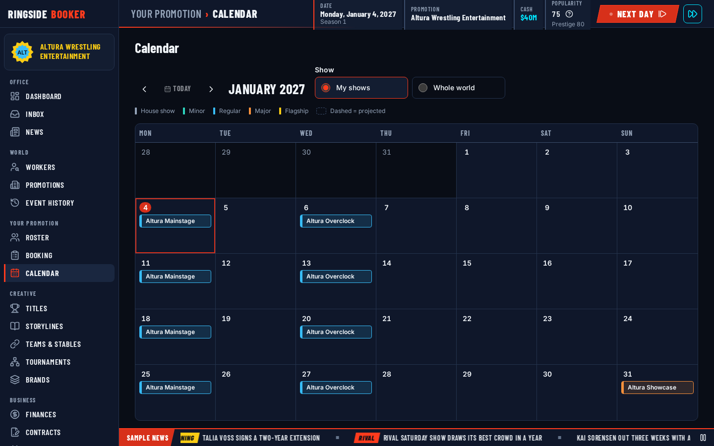
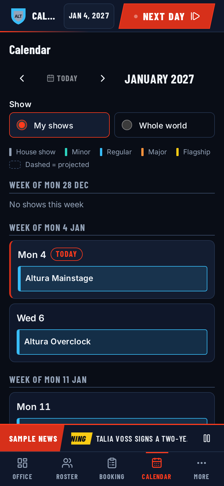

# Calendar

The calendar turns event definitions (a promotion's weekly TV, monthly specials
and annual big shows) into dated shows. Every show feature reads those dated
shows, so this is where they come from. The code is in
`packages/engine/src/systems/calendar/`.

Nothing here is random. The schedule is fully decided by the data, so the
calendar has no RNG stream and the same world always gets the same shows with
the same ids.

## Horizon

Shows are **stored** only a fixed distance ahead. `calendar.scheduleHorizonDays`
(default 90) is that distance: at any time the `eventInstances` table holds
every show from today through today + 90 days, for every promotion. Dates past
the horizon are **projected** when a screen asks for them and never stored, so
a ten-year game does not carry ten years of empty shows.
`calendar.projectionMaxDays` (default 400) caps how far the projection looks.

Two things keep the stored window full:

- **New game.** The setup step `calendar.scheduleOpening` (order 810, straight
  after `wld.storeSettings`) schedules the start date through start + horizon.
  It runs after founding, so a founded promotion's weekly show is included. It
  reads the horizon from the session's tunables, so an override picked in the
  new-game wizard applies.
- **Every day.** The phase `calendar.extendHorizon` (housekeeping, order 20,
  daily) schedules tomorrow through tomorrow + horizon.

### Why the daily window starts tomorrow (the `+1`)

The clock moves to `date + 1` when the day closes. A phase running on day `D`
that fills `D + 1` through `D + 1 + H` leaves the player, who is now on
`D + 1`, looking at exactly today through today + `H`.

The window never includes the day being simulated. A definition that is created
or changed today can never get a surprise show on a day that is already
running, which would then close as "Not run". The setup step covers the start
date itself, because no phase has run for it.

With the horizon at 0, the stored window is just today: each day stores only
the next day's shows, and nothing after today is ever on the books. Zero means
zero.

An older game that has no stored shows heals itself: its first simulated day
fills tomorrow onward.

### Which definitions are scheduled

A definition is schedulable when its promotion is `active` and it is
promotion-wide or its brand is active. Dormant and closed promotions and
inactive brands get nothing. Definitions are visited in ascending id order.

`occurrencesBetween(definition, from, to)` lists the dates, both ends included,
clipped to the definition's `activeFrom` and `activeUntil`. One call lists at
most 400 dates for one definition. Only a show that runs every day of the week
can reach that, and only when the horizon is tuned above 400 days; it is then
stored 400 dates ahead instead, and the daily run keeps that many on the books.
A weekly show has under 110 dates even at the largest horizon of 730 days.

### The idempotency key

A recurring show is identified by its definition and its **air date**. The
`eventInstances` table has a unique index, `byDefinitionAirDate`, keyed
`<definitionId>|<airDate>`, and scheduling skips any date that already has a
row under that key, whatever the row's status. So:

- running the schedule twice creates nothing the second time, and on an
  unchanged world a day creates only the shows for the newly reached date;
- a cancelled show is never created again;
- a show taped on an earlier day keeps its air date, so its slot stays taken.

One-off shows have no definition and are left out of the index.

A new show copies `promotionId`, `brandId`, `name`, `importance` and `format`
from its definition, has `date` and `airDate` on the occurrence, and starts as
`scheduled`. Copying is deliberate: editing a definition later never rewrites
shows that are already stored.

### Events

- `show.scheduled { eventInstanceId, promotionId, date }`: one per show the
  daily phase adds, about two a day across the default world.
- `calendar.horizonExtended { from, through, created }`: one summary from the
  new-game setup step.

The setup step does not publish an event per show. The default world opens
with about 150 shows, and that many events at once would fill the
recent-events log before the player has done anything. A listener that needs
every opening show reads the table when `world.created` arrives, which is
published after the opening schedule.

## Placement

`placeShow(read, definition, date)` decides where a show is held and returns
the answer with a decision trace, for the Why? on the show sheet.

Venue:

1. The definition's preferred venue is used when it exists, is open on the day
   (`openedOn` is null or on or before the date, and `closedOn` is null or
   after it) and is either open to everyone or exclusive to the show's own
   promotion.
2. Otherwise the venue is left empty, which means "not chosen yet". Venue
   picking fills it in later.

Region, first match wins:

1. the definition's preferred region;
2. the region of the venue chosen above;
3. the promotion's home region.

Every show therefore has a region, even with no venue. The trace records each
rule that was checked and whether it passed, and its value says whether the
preferred venue was used (`preferredVenue`) or left open (`notChosen`).

## Lifecycle

A show moves `scheduled` → `completed`, or ends as `cancelled`. (`booked` is no longer written:
there is no lock since EVT2-09, and an old save's `booked` show counts as open.)

| Status      | Meaning                                                |
| ----------- | ------------------------------------------------------ |
| `scheduled` | On the books with no finished card                     |
| `booked`    | Old saves only: a card locked before EVT2-09; open     |
| `completed` | It ran. The row carries its `result`                   |
| `cancelled` | It will not happen. The row carries its `cancellation` |

`scheduled` and `booked` are the two **open** statuses. `completed` and
`cancelled` are final: nothing moves a show out of either.

A cancelled show carries a `cancellation` record, `{ reason, on }`, so the two
ways a show can fail to happen stay apart:

| Reason        | Meaning                                   |
| ------------- | ----------------------------------------- |
| `notRun`      | Its day ended with the show still open    |
| `byPromotion` | The controller that runs it called it off |

`on` is the day the show was cancelled, not the show's own date. A show for
20 January called off on the 5th has `on` set to the 5th, which is what lets
the show sheet say "Cancelled by you on 5 Jan".

`cancellation` is set exactly when the status is `cancelled`, the same way
`result` is set exactly when the status is `completed`. The `byStatus` index
lets a phase read only the open shows instead of scanning every stored one.

### Closing shows that did not run

The phase `calendar.closePastShows` (settlement, order 90, daily) keeps the
calendar honest. It takes every open show dated **today or earlier**, in id
order, sets it to `cancelled` with reason `notRun`, and publishes one
`show.cancelled` for each. At the end of any day, no `scheduled` or `booked`
show is dated on or before that day.

Why there, and not earlier in the day:

- It runs after the whole `shows` group. A show that ran today is already
  `completed` by the time the close looks, so only the ones nobody ran are
  closed. Until show night exists, that is every show.
- It runs in `settlement` at a high order, after anything that settles a
  show's takings, and before `growth`, `money` and the periodic jobs, so they
  all see the day's final statuses.
- "Today or earlier" rather than "today" is the safety net. If the close
  itself fails one day, its writes are rolled back and the shows stay open;
  the next day's run picks them up.

A feature that needs to react to an unrun show (a missed TV airing, lost
momentum) subscribes to `show.cancelled`. It does not move this phase or run
ahead of it.

A booked show that does not run closes the same way as an unbooked one. The
row does not say whether it had a card; a screen that wants to tell "Not run"
from "Not run (no card)" counts the show's segments.

### Who controls a show

One rule, in `control.ts`, used by every command, gate and screen that needs
to know whose show it is:

1. If the show belongs to a brand and that brand has a controller of its own,
   that controller runs the show.
2. Otherwise the promotion's controller does.

So a brand handed to a second player, or to the computer as a GM, takes its
shows with it, and a promotion-wide show always stays with the promotion.

| Helper                                   | Answers                                          |
| ---------------------------------------- | ------------------------------------------------ |
| `showControllerOf(read, show)`           | The controller that runs the show                |
| `sameController(a, b)`                   | Both the computer, or both the same human player |
| `controlsShow(read, show, controller)`   | Does this controller run the show?               |
| `viewerControlsShow(read, show, viewer)` | The same for a query's viewer                    |

The omniscient viewer sees every show and runs none, so
`viewerControlsShow` is always false for it. Two computer controllers count
as the same controller: the computer is one seat, however many promotions it
runs.

Nothing else reads a brand's or a promotion's `controller` to decide who may
act on a show.

### Cancelling a show

`calendar.cancelShow { eventInstanceId }` calls off one show. Schedules are
public, so anyone can see a rival's shows, but only the controller that runs
a show can cancel it. The first rule that fails is the one the player is
told about:

| Code               | Refused when                            | The player reads                                                   |
| ------------------ | --------------------------------------- | ------------------------------------------------------------------ |
| `notFound`         | There is no such show                   | "That show no longer exists."                                      |
| `notYourShow`      | The issuer is not the show's controller | "Only the promotion (or brand) that runs this show can cancel it." |
| `alreadyCancelled` | The show is cancelled                   | "This show has already been cancelled."                            |
| `alreadyCompleted` | The show has run                        | "This show has already taken place."                               |
| `showInPast`       | The show's date is before today         | "This show's day has passed."                                      |

Today's show can still be cancelled before the day runs. A human can never
cancel a computer promotion's show, and the computer can only cancel shows
the computer runs. Like every command, it is refused while the game is moving
forward.

When it applies, the show becomes `cancelled` with reason `byPromotion` and
today's date, and `show.cancelled` is published. Three things it does not do:

- **It never deletes the row.** The cancelled show keeps its place in the
  `byDefinitionAirDate` index, so the daily horizon skips that date for good
  and a cancelled show never comes back.
- **It does not touch the show's segments.** What happens to a card when
  its show is cancelled belongs to booking.
- **It costs nothing and upsets nobody.** Cancelling has no price and no
  effect on anyone's morale here. If a later feature adds a reaction, it has
  to follow D-09.

### Events

- `show.cancelled { eventInstanceId, promotionId, date, reason }`: one per
  show closed by the daily phase (`notRun`) and one per cancel command
  (`byPromotion`). `date` is the show's date.

## Queries

Screens read the calendar through four queries. None of them changes anything,
and they all return the same row, so a month grid, a show sheet and the "Next
show" tile agree about every show. The code is in `queries.ts`, the row in
`view.ts`.

| Query                | Args                                          | Returns                                           |
| -------------------- | --------------------------------------------- | ------------------------------------------------- |
| `calendar.range`     | `{ from, to, scope, promotionId?, brandId? }` | `{ today, horizonEnd, shows }`: the stored shows  |
| `calendar.projected` | `{ from, to, scope, promotionId?, brandId? }` | `{ today, projectionEnd, shows }`: not stored yet |
| `calendar.show`      | `{ eventInstanceId }`                         | One stored show with its detail, or null          |
| `calendar.nextShow`  | `{ scope? }` (default `mine`)                 | `{ show, daysUntil }`, or null                    |

### The row

`CalendarShow` is plain JSON:

| Field             | What it holds                                                         |
| ----------------- | --------------------------------------------------------------------- |
| `key`             | The show's id, or `<definitionId>\|<date>` for a projected show       |
| `eventInstanceId` | The show's id, or null when projected                                 |
| `definitionId`    | The definition it comes from, or null for a one-off                   |
| `promotion`       | `{ id, name, shortName, color }`                                      |
| `isOwn`           | True when the viewer is the human player who runs the show            |
| `brand`           | `{ id, name }`, or null for a promotion-wide show                     |
| `name`            | The show's name                                                       |
| `importance`      | `house` to `flagship`                                                 |
| `format`          | `{ slots, preShowSlots }`                                             |
| `televised`       | From the definition as it stands now; null for a one-off              |
| `date`, `airDate` | The day it runs and the day it airs                                   |
| `status`          | `scheduled`, `booked`, `completed`, `cancelled`, or `projected`       |
| `cancellation`    | `{ reason, on }` for a cancelled show, otherwise null                 |
| `region`          | `{ id, name, countryName }`                                           |
| `venue`           | `{ id, name, capacity, kind }`, or null while the venue is not chosen |
| `segmentCount`    | How many segments are on the card                                     |
| `canCancel`       | True when the viewer could cancel the show right now                  |
| `score`           | The show score once `completed` (EVT3-06), otherwise null             |

A projected show has no id, so screens key rows by `key` and hide anything
that needs an id (Book, Cancel) for them.

Two things are never in a row:

- **Money.** Schedules are public: a real promotion's TV dates are no secret,
  so every viewer sees every promotion's shows, where they are held and
  whether they ran. What a rival's show took at the gate is not public. The
  row is built field by field and the show's `result` is never copied (only
  its `score`, which was public the night the show aired), and no calendar
  query reads a promotion's cash. That holds for the viewer's own
  shows too; a show's takings belong to the show report.
- **Lengths.** A show has slots, not a running time (D-10). No field is a
  number of minutes or a clock time.

`canCancel` is `isOwn` plus the rules of `calendar.cancelShow`: the show is
still open and dated today or later. The command and the row both ask one
helper, `cancelRefusal(read, show, controller, today)`, so a Cancel button
is never offered for a show the command would refuse.

### Scopes and viewers

`scope` is `world` for every promotion's shows or `mine` for the shows the
viewer runs. `promotionId` and `brandId` narrow either scope, for a
promotion's calendar tab and a brand's shows tab.

| Viewer                   | `world`                              | `mine`                 |
| ------------------------ | ------------------------------------ | ---------------------- |
| A human who runs shows   | Everything; their own marked `isOwn` | The shows they control |
| A human who runs nothing | Everything, none `isOwn`             | Empty                  |
| The computer's seat      | Everything, none `isOwn`             | Empty                  |
| The omniscient viewer    | Everything, none `isOwn`             | Empty                  |

"Controls" is the rule in [Who controls a show](#who-controls-a-show), so a
brand handed to a second player shows up in that player's `mine`.

The computer's seat gets the world view only. A screen is only ever drawn for
the computer's seat when a player is between jobs, and that player runs none
of the computer's promotions: marking every computer show as their own would
offer them a Cancel button on all of them. So `isOwn` asks for a human
controller on top of the control rule. The command is untouched: the computer
can still cancel the shows it runs.

### Range

`calendar.range` walks the `byDate` index one day at a time from `from`
through `to`, both included, and returns the stored shows of every status.
`horizonEnd` is today plus `calendar.scheduleHorizonDays`, which tells the
screen where stored shows stop and projected ones begin.

Shows are sorted by date, then importance (flagship first), then promotion
name, then `key`. The key is unique, so the order never depends on how the
rows were found.

A window covers at most 366 days (`to - from`), enough for a year view across
a leap year. A query has no rules step, so the limit is part of the argument
check. Both refusals come back as `invalidArgs` on the field `to`:

| Refused when                | The player reads                                |
| --------------------------- | ----------------------------------------------- |
| `to - from` is over 366     | "A calendar range can cover at most 366 days."  |
| `to` is earlier than `from` | "A calendar range cannot end before it starts." |

The engine puts the field in front of an argument message, so the reason's
`message` reads "to: A calendar range can cover at most 366 days.".

### Projection

`calendar.projected` fills in the dates past the horizon. For every
schedulable definition (the same test the daily schedule uses) it lists the
occurrences between

- the later of `from` and the day after `horizonEnd`, and
- the earlier of `to` and today plus `calendar.projectionMaxDays`,

and returns one row for each that has no stored show under
`byDefinitionAirDate`. Nothing is written. A projected row has status
`projected`, no id, no cancellation, a `segmentCount` of 0, `canCancel`
false and a null `score`, and its region and venue are what `placeShow` picks today.

Because the stored-show check is the schedule's own idempotency key, the two
queries never return the same airing twice: the day the horizon reaches a
date, the show moves from `calendar.projected` to `calendar.range`. A date
whose show was cancelled is not projected either, because the cancelled row
still holds the key.

The window takes the same 366-day limit as `calendar.range`, and
`projectionEnd` is returned so the screen can stop offering "next" where the
projection stops. With `calendar.projectionMaxDays` at 0 there are no
projected shows. A definition's `activeUntil` ends its projection, and a
dormant or closed promotion projects nothing.

A projected show is a forecast, not a promise: a definition that changes
before the horizon reaches a date changes what is stored for it.

### One show

`calendar.show` returns the row plus:

- `placementTrace`: the decision trace of `placeShow` for the show's
  definition and date, for the Why? on the show sheet. It is returned only
  while the stored venue and region are still what the rule picks. Once
  something else has set either one, the rule no longer explains where the
  show is, and the field is null. It is also null for a one-off.
- `definition`: `{ recurrenceText }`, or null for a one-off.

`recurrenceText(recurrence)` says how often a show runs:

| Kind          | Reads                                                    |
| ------------- | -------------------------------------------------------- |
| `weekly`      | "Every Monday", "Every Monday and Thursday", "Every day" |
| `everyNWeeks` | "Every 2 weeks on Saturday"                              |
| `monthly`     | "Last Sunday of every month"                             |
| `annual`      | "2nd Sunday of February every year"                      |
| `dates`       | "On 1 set date", "On 4 set dates"                        |

It lives in the engine so every screen that describes a schedule says it the
same way. It names weekdays, weeks and months, never a time or a length.

### The next show

`calendar.nextShow` returns the first open (`scheduled` or `booked`) show
dated today or later, in the calendar order above, with `daysUntil` (0 for
today). It reads the open shows through the `byStatus` index instead of
walking dates: there are never more open shows than the horizon holds, and
it finds the next one however far ahead it is. It returns null when nothing
is open, which for `mine` includes every viewer who runs no shows.

### Cost

On the default world after two simulated years, a 42-day `calendar.range`
for the whole world (65 shows) takes about 0.2 ms and a 42-day
`calendar.projected` (68 shows) about 0.45 ms, against a budget of 20 ms
each. The benchmark is
`packages/engine/test/systems/calendar/queries.bench.ts`.

## Screen

Code: `apps/web/src/screens/calendar/`, whose README covers the files, the URL
state, the keyboard and the extension slots. This section is what the player
sees and where each value on it comes from.

On a desktop window the month is a grid, Monday first, with up to three shows
on a day and the rest behind "+N more". Picking a show opens its sheet at the
side.

Below `--bp-mobile` the same month is an agenda grouped by week, and the sheet
comes up from the bottom of the screen.

A chip says whose show it is with a tag: the brand in My shows, the
promotion's short name in Whole world. A brand named after its own weekly show
would only repeat the name beside it, so that tag is left out and the name
gets the room.

### What is stored and what is worked out

Every derived value on a screen has to explain itself. On the calendar and
the show sheet almost everything is a stored fact printed as it is:

| Value                            | Where it comes from                                            | Why?                                  |
| -------------------------------- | -------------------------------------------------------------- | ------------------------------------- |
| Date, and "Airs" when it differs | Stored on the show                                             | Not needed                            |
| Promotion, brand                 | Stored on the show                                             | Not needed                            |
| Importance                       | Stored on the show (copied from its definition)                | Not needed                            |
| Card ("6 main slots")            | The show's stored format, as slot counts                       | Not needed                            |
| Television                       | The definition's stored flag                                   | Not needed                            |
| Runs ("Every Monday")            | The definition's stored recurrence, put into words             | Not needed                            |
| Status                           | Stored status, plus the stored cancellation reason and day     | Not needed                            |
| "(no card)" on a not-run show    | The show has no segments                                       | Not needed: the words are the reason  |
| "+N more", shows on a day        | A count of the chips listed behind it                          | Not needed: the list is the breakdown |
| Region and venue                 | **Derived** by the placement rule ([Placement](#placement))    | Yes, beside the venue                 |
| Region and venue, projected      | The same rule, as a forecast for a date that is not stored yet | No: the sheet says it is a projection |

The venue's Why? opens the placement decision. Its headline is the outcome in
the player's words (the venue's name, or "Not chosen yet"), followed by the
engine's own reason and each rule it checked. The rule keys the engine uses
for the outcome (`preferredVenue`, `notChosen`) never reach the screen.

Nothing on the calendar states a running time: a card is slots
(`design-decisions.md` D-10). The engine tests check the rows and the web
tests check the words.

### The hand-test script as a test

`packages/engine/test/systems/calendar/walkthrough.test.ts` starts a new game
on the shipped default world as its biggest promotion and checks the dates,
names and counts a person testing the calendar is told to expect: the weekly
shows of January 2027, the major shows, the rivals' weekdays, the busiest
Saturday, the first projected date and what one day does to it, a cancelled
show after a save and a reload, and an unbooked show after its day passes. If
the world pack moves a show, that test fails and the script needs the new
date.

## Integration

The calendar is finished on its own: shows are scheduled, drawn, closed and
cancelled without any other feature. The features below work with it. Each one
connects through a door listed here and never by editing the calendar's own
files, and each one does its wiring in its own code when it is built.

**Wired today: none.** None of these features is in the game yet, so every
calendar slot is empty and every "until then" below is what the player sees.

| Feature         | Door it uses                                                                                      | Until then                                                          |
| --------------- | ------------------------------------------------------------------------------------------------- | ------------------------------------------------------------------- |
| Booking         | Sheet action `booking.book`; `controlsShow` for its gates; sets `booked` and back to `scheduled`  | A show cannot be given a card; a past one reads "Not run (no card)" |
| Schedule editor | Toolbar item `calendar.newShow`; `scheduleDefinitionWindow` after every create, change and retire | Only the shows in the world data exist                              |
| Rival calendars | `scheduleDefinitionWindow` when a rival adds a show; `calendar.range` and `calendar.projected`    | Rivals run only the shows they start with                           |
| Skip days       | A skip target `calendar.nextShow`, from `calendar.nextShow { scope: 'mine' }`                     | Skip days has no "Until next show"                                  |
| Office          | An office panel `calendar.nextShow`, from `calendar.nextShow` and `calendar.range`                | The Office has no Next show panel                                   |
| Brands          | `calendar.range { brandId }`; future `scheduled` shows follow a definition that changes brand     | A show's brand tag is the one its definition started with           |
| Hype            | Chip badge and sheet section `eco.hype`                                                           | Chips and sheets say nothing about hype                             |
| TV deals        | The `show.cancelled` event; sheet section `eco.airing`                                            | The sheet does not say where a show airs                            |
| Drafts          | Day markers `brw.draft`; a chip badge on the show a draft airs on                                 | No draft day is marked                                              |

The slots (sheet action, sheet section, chip badge, day markers, toolbar item)
are described in `apps/web/src/screens/calendar/README.md`, which also lists
the ids registered so far.

Three rules hold for every feature in the table:

- **Shows made during a day schedule themselves.** The daily horizon step runs
  in `housekeeping`, before rivals take their turns, so a definition created
  later the same day would wait until tomorrow. Whatever creates or changes a
  definition calls
  `scheduleDefinitionWindow(tx, read, definitionId, today, today + H)` in the
  same transaction, where `H` is `calendar.scheduleHorizonDays`, and the show
  is on the calendar at once. The idempotency key makes a second call
  harmless.
- **One answer to "who controls this show".** Every gate and command that
  needs it calls `showControllerOf` or `controlsShow`. Nothing compares a
  promotion's controller for a show on its own.
- **Cancelling writes one row.** `calendar.cancelShow` changes the show and
  nothing else. A feature that keeps something per show (a card, an airing)
  listens for `show.cancelled` and decides for itself what that means; a card
  stays as read-only history.
