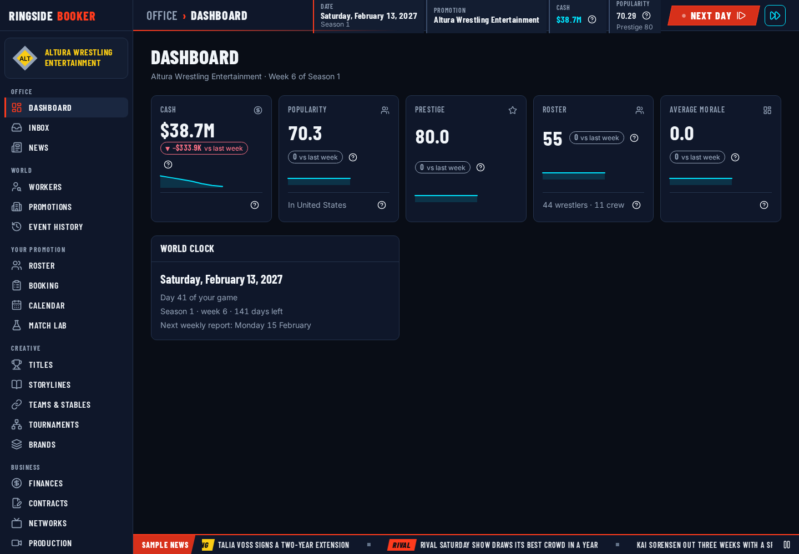
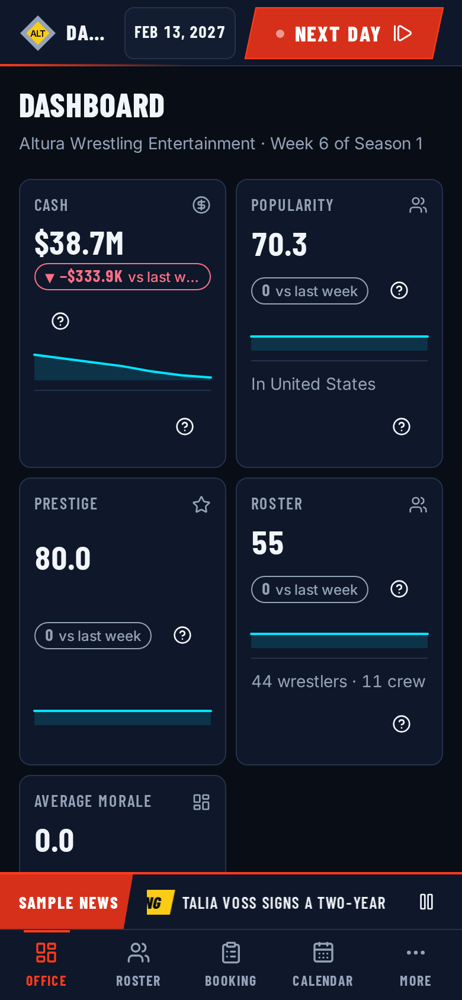
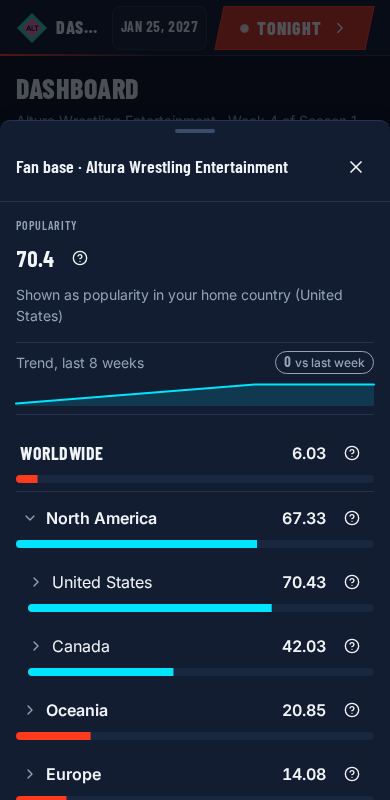

# The Office

The Office is the promotion's front page: cash, prestige, popularity, roster
and morale, with how each has moved. DAY2 builds it in steps. This doc starts
with the history behind it (DAY2-01); the headline figure (DAY2-02), the
KPIs, deltas and sparklines with their queries (DAY2-03) and the screen itself
(DAY2-04) add their own sections.

Code: `packages/engine/src/systems/office/`.

## History

Before DAY2 the engine kept no history of a promotion at all, so nothing could
say "up 3 since last week" or draw a line. The `promotionSnapshots` table is
the one place promotion history lives (a person's history is WRK4's
`personSnapshots`). Rows are plain facts: no random draw and no trace is
stored with them. The Office rebuilds the live value's Why? when it reads it,
which keeps the trace store free of hundreds of weekly entries a year.

### Columns

| Column                       | What it holds                                                                                          |
| ---------------------------- | ------------------------------------------------------------------------------------------------------ |
| `cash`                       | The promotion's cash at the end of the day, in cents                                                   |
| `prestige`                   | The promotion's prestige                                                                               |
| `popularity.world`           | The population-weighted world roll-up of `regionalPop` (D-03, WRK1's roller)                           |
| `popularity.byContinent`     | Every continent's roll-up; sparse, a continent at 0 is left out                                        |
| `popularity.homeRegionValue` | The stored value in the home region, 0 when none is stored                                             |
| `popularity.headline`        | The [headline popularity](#headline-popularity) (`headlinePopularityValue`), same scope as the top bar |
| `rosterSize`                 | People with an active contract that has started (`startsOn` on or before the day)                      |
| `averageMorale`              | The mean morale of those contracts, unrounded; null when nobody is under contract                      |
| `extra`                      | Registered fields, one number each (see [the registry](#the-registry))                                 |

Roll-ups are kept inside 0..100. One roller is built per run and shared by
every promotion.

### Cadence and the baseline

- **Weekly**: the `office.weeklySnapshot` phase runs every Monday in the
  `periodic` group (order 34), after the day's shows, settlement, growth and
  money, so a Monday row already includes that Monday's show and payroll. It
  writes one `week` row for every `active` or `dormant` promotion, in id order,
  and publishes `office.snapshotTaken { date, promotionIds }`. Closed
  promotions stop getting rows but keep the history they have.
- **Baseline**: the `office.baselineSnapshot` new-game setup step (order 990,
  after every other step) writes one `baseline` row dated the start date for
  every active promotion, so the first week already has something to compare
  with. A game that starts on a Monday turns that row into the Monday's `week`
  row when the day is simulated, instead of adding a second row for the same
  day.

At most one row exists per promotion per day: the `byPromotionDate` index is
unique, and the phase updates an existing row rather than creating another.

### Granularity

| Granularity | Meaning                                                     |
| ----------- | ----------------------------------------------------------- |
| `week`      | A Monday within the full-detail window                      |
| `month`     | The last kept row of a calendar month older than the window |
| `baseline`  | The day the game started; never thinned or deleted          |

### Retention

Weekly rows add up over a long career, so old weeks are thinned. After writing,
the same phase looks at every row dated before
`date − 7 × office.history.fullDetailWeeks` days (52 weeks by default). Those
rows are grouped by promotion and calendar month; in each group the latest row
is kept and set to `month`, and the others are deleted. Baseline rows are
never touched. The plan is a pure helper, `planCompaction(rows, cutoff)`, and
running it again changes nothing.

A promotion therefore holds at most `fullDetailWeeks + 1` weekly rows, one row
per older month and its baseline. With the default of 52 weeks, a year of play
holds at most 53 rows per promotion; twenty years hold about 53 + 12 × 19, or
roughly 280. Lowering `fullDetailWeeks` takes effect on the next Monday. The
headless runner's `--strict` checks these limits after every run and prints the
table's size in its summary.

On the default world a year of play writes 636 rows (12 promotions × 53) at
about 330 bytes each: a 365-day save grows from 8.91 MB to 9.12 MB.

### The registry

Other features add a number to every row without a schema change by
registering a field:

```ts
registerPromotionSnapshotField({
  key: 'morale.trend', // lower camelCase words joined by dots
  label: 'Morale trend',
  unit: 'points', // 'points' | 'money' | 'count' | 'percent' | 'ratio'
  visibility: 'owner', // 'public' | 'owner'
  extract: (promotion, read, date) => value, // number, Traced<number> or null
  kpi: { order: 30, goodWhen: 'up', footer: 'Last 8 weeks' }, // optional
});
```

- The value lands in the row's `extra` map under its key from the next
  snapshot on. Rows written before the field was registered lack the key: an
  absent key means "not recorded that week", while 0 is stored as 0.
- `extract` returning null records nothing that week.
- A traced extract stores only its value; the Office re-runs it live for the
  current Why? (DAY2-03).
- A key that is malformed, already registered or clashes with a built-in
  column (`cash`, `prestige`, `popularity` and `popularity.*`, `rosterSize`,
  `averageMorale`) throws a `RegistryError` naming the key.
- `promotionSnapshotFields()` lists the fields in key order; the function
  `registerPromotionSnapshotField` returns removes the field again (for tests).
- **Visibility**: `public` fields may be shown for any promotion; `owner`
  fields only to the player who runs the promotion. The history query that
  hands rows to the UI (DAY2-03) enforces it; the stored row holds every field.

Keep each field a single number. Anything structured, such as a per-region
map, belongs in its owning feature's own table. Features expected to register
fields: SOC3 (morale trend), ECO3 (hype), ECO2 (prestige), DAY4 (rankings)
and POL2 (balance charts). AIP5's hot shots read the built-in popularity
column instead.

### Tunables

| Key                              | Default | Range | Meaning                                                                    |
| -------------------------------- | ------- | ----- | -------------------------------------------------------------------------- |
| `office.history.fullDetailWeeks` | 52      | 4–520 | Weeks kept at full weekly detail before older weeks are thinned to monthly |
| `office.trend.weeks`             | 8       | 2–52  | Weeks shown in a KPI sparkline (read by DAY2-03)                           |
| `office.delta.lookbackDays`      | 7       | 1–90  | How far back a KPI delta compares (read by DAY2-03)                        |

DAY2-03 adds `office.morale.namedInWhy` (see [KPIs and deltas](#kpis-and-deltas)).

## Headline popularity

A promotion's popularity is stored per region and rolled up by population to
countries, continents and the world (D-03). The top bar and the Office need
one number, so DAY2-02 picks one of those levels as the promotion's
**headline popularity**:

| Key                               | Default       | Options                                               | Meaning                                                                          |
| --------------------------------- | ------------- | ----------------------------------------------------- | -------------------------------------------------------------------------------- |
| `office.popularity.headlineScope` | `homeCountry` | `homeRegion`, `homeCountry`, `homeContinent`, `world` | Which D-03 roll-up the Office and the top bar show as the promotion's popularity |

Code: `formulas/headlinePopularity.ts` (the formula), `popularity.ts`
(`headlinePopularityOf`, `headlinePopularityValue`, `recordHeadlinePopularity`)
and `queries.ts` (`office.fanBase`).

### One roll-up level, not a new formula

The headline **is** the chosen roll-up, worked out by WRK1's
`popularityRollup` (traced) or `createPopularityRoller().rollValues` (the fast
path), kept within 0..100. There is no other arithmetic, so the figure never
disagrees with the Fan base sheet, which draws the same roll-up. Its Why?:

- root "<Promotion> popularity";
- the main line, the chosen level's own roll-up trace ("Popularity in
  <country>", each region with its value × its share of the population),
  shortened to leave `HEADLINE_TRAIL_NODES` (60) of the 400-node budget for
  the lines after it;
- the scope, read through the builder so the Why? names
  `office.popularity.headlineScope` ("Shows popularity in the home country");
- two notes for context, "Worldwide 24.1" and "Home region <name> 75" (the one
  that would repeat the main line is left out);
- the [trace sections](#trace-sections) lines;
- the 0..100 clamp.

`headlinePopularityValue(read, promotionId, tunables, roller)` gives the same
number with no trace (equal within 1e-9), for snapshots and list rows. AIP1,
DAY4 and BRW should use it whenever they want "a promotion's popularity" as one
number.

**Not reach.** ECO1's `reachOf` ([finances.md](finances.md#reach-and-size))
is a weighted blend of all four levels (weights 1, 3, 2, 2) that answers how
far the company's name carries and sets its size label. The headline is a
single level the player can find again on the map. Both read the same
`regionalPop` through the same roll-up, so they move together, but they are
different numbers and should not be swapped for each other.

On the default world the home-country default reads a little below the home
region (Altura: about 70 against 75); the top bar's label changes from
"Popularity in your home region" to the trace's "<Promotion> popularity", whose
Why? names the country.

### The stored trace

The Why? is stored under `{ kind: 'office.popularity', id: promotionId }`.
The kind string is core's (`POPULARITY_TRACE_KIND` in `core/api/builtins.ts`,
re-exported by `systems/office/traces.ts`), as ECO1 does for `finance.cash`,
so `sim.status` reads it without importing this system. Recording the same ref
replaces the entry, so each promotion has one. It is re-recorded:

1. by the `office.baselineSnapshot` setup step, for every active promotion;
2. by the `office.popularityChanged` subscription, after every
   `popularity.changed` whose `subjectKind` is `promotion` (WRK1's door
   publishes it for every popularity write, EVT5's shows included);
3. by the `office.weeklySnapshot` phase every Monday, for every active
   promotion (this also repairs a trace dropped by retention);
4. by the `office.headlineScopeChanged` subscription, for every active
   promotion, when `tunables.changed` names `office.popularity.headlineScope`.

With 12 promotions this is far below `sim.traceRetentionPerKind` (200). A
world made before DAY2-02 has no trace until its first Monday: `sim.status`
then returns `headline: null` and the top bar keeps the home-region value and
its Why? built on the spot ([engine-api.md](engine-api.md#the-status-and-pending-gate-queries)).

### `office.fanBase`

Args `{ promotionId? }` (default: the viewer's first promotion). Result
`{ promotionId, name, headline: { value, label, traceRef }, scope, rollup, home }`,
where `rollup` is WRK1's `PopularityRollupView` (world → continents →
countries → regions, every derived level with its trace) for the Fan base
sheet's `PopularityDrilldown`. `home` is `{ regionId, countryId, countryName, continentId }`, where
the promotion is based (DAY2-05: the sheet opens on the home continent and
names the home country). `headline` reads the stored trace (the same
entry `sim.status` reads, so the two always agree); with none stored it is
built on the read and `traceRef` is null. Popularity is public, so any viewer
may ask about any promotion. Refusals: `noPromotion` ("You don't run a
promotion, so pick one to look at") and `unknownPromotion`.

### Trace sections

Other features add lines to the Why? without the office system knowing about
them:

```ts
registerPopularityTraceSection({
  id: 'promoPop.recentShows', // unique; a duplicate throws a RegistryError
  order: 10, // lower first, then by id
  lines: (read, promotionId, date) => ['Recent shows: Monday Mayhem on 5 January, worldwide +0.8'],
});
```

Each line becomes a `note` after the context notes, sections in order. A
section returning no lines adds nothing. Lines are worked out whenever the
trace is re-recorded (the four moments above), so a section reads the world as
it stands then; EVT5's show change publishes `popularity.changed`, so a
"Recent shows" section is current after every show. The function
`registerPopularityTraceSection` returns removes the section (for tests).

Registered sections:

| Id                     | Order | Owner | Lines                                                                                                                                                            |
| ---------------------- | ----- | ----- | ---------------------------------------------------------------------------------------------------------------------------------------------------------------- |
| `promoPop.recentShows` | 10    | EVT5  | "Recent shows: Big Night on Tue 6 Jan, worldwide +0.8", the newest three shows dated on or before the Why?'s day (DAY2-06, `systems/promoPop/officeSections.ts`) |

## KPIs and deltas

DAY2-03 turns the history into the Office's cards. Code:
`dashboard/kpis.ts` (assembly), `formulas/kpiDelta.ts`, `formulas/rosterSize.ts`,
`formulas/averageMorale.ts` and `history/compare.ts`.

### The cards

| Key                   | Card           | Live value                                                 | Why?                                                    | Footer                      |
| --------------------- | -------------- | ---------------------------------------------------------- | ------------------------------------------------------- | --------------------------- |
| `cash`                | Cash           | The promotion row's cash (equals `sim.status`)             | ECO1's stored `finance.cash` trace (`traceRef`)         | A "Finances" link (DAY2-06) |
| `popularity.headline` | Popularity     | The stored headline Why?'s value (equals `sim.status`)     | DAY2-02's stored `office.popularity` trace (`traceRef`) | "In <country>"              |
| `prestige`            | Prestige       | The promotion row's prestige                               | None until ECO2 moves prestige                          | none                        |
| `rosterSize`          | Roster         | Active contracts that have started (the snapshot's rule)   | `rosterSize`, inline                                    | "44 wrestlers · 11 crew"    |
| `averageMorale`       | Average morale | The mean morale of those contracts; null ("–") with nobody | `averageMorale`, inline                                 | none                        |

Then every [registered field](#the-registry) with `kpi` set, by `kpi.order`
(then key). Its extract is re-run live: a traced extract gives the card its
inline Why?, a plain number gives none. Owner-only fields are shown: the
dashboard only builds cards for the viewer's own promotion. A popularity
figure with no stored Why? yet (a world made before DAY2-02, until its first
Monday) is built on the read and shown inline instead.

Inline traces (`trace`) are used for numbers worked out on the read (deltas,
roster, morale); stored refs (`traceRef`) only where a system already records
one. Nothing new is kept in the trace store, and every Why? is current. On the
default world Altura's dashboard is about 7 kB of JSON (target: under 30 kB,
since the screen refetches it after every simulated day).

- **Roster size**: one line per role with anyone in it ("Wrestlers 44"),
  added up.
- **Average morale**: each role group as one line ("Wrestlers: 44 contracts,
  average 12.0", adding that group's total), divided by the number of
  contracts, then notes naming the `office.morale.namedInWhy` lowest ("Low
  morale: <ring name> -6.0"; lowest first, then by name). Nobody under
  contract gives 0 with the note "Nobody is under contract"; the card shows
  "–".

| Key                        | Default | Range | Meaning                                                 |
| -------------------------- | ------- | ----- | ------------------------------------------------------- |
| `office.morale.namedInWhy` | 3       | 0–10  | Lowest-morale people named in the average morale's Why? |

### The delta rule

"Last week" is a lookback rule, not a calendar rule, so it still works after a
long skip or a mid-week start. A card compares with the **latest row dated on
or before `today − office.delta.lookbackDays`** (`previousSnapshot`). Every
card uses the same row. With no such row, or a row that lacks the metric (a
field registered later, no morale to average), the card has `delta: null`:
never a fake 0.

`kpiDelta` works out `delta = current − previous`, unrounded (screens round).
Its Why?: "Change in <label> since <date>", starting from "This week
(<today>)" (or the live value's own nested Why?), minus "Last week (<date>)",
with dates such as "Mon 11 Jan". Notes make an odd comparison visible:

- a row older than the lookback plus 6 days: "The last record before that is
  from <date>, <n> days ago" (and the line reads "Last record (<date>)");
- a monthly row: "Older weeks are kept as one record a month, so this compares
  with a monthly record";
- the baseline row: "This compares with the day the game began".

### Trends

A card's `trend` is its rows dated after `today − 7 × office.trend.weeks` and
before today, oldest first, then the live value dated today, so a sparkline
always ends at "now". A row without the metric is skipped, not drawn as 0. A
null live value (no morale) adds no last point.

## World clock

`office.dashboard`'s `clock` (`dashboard/clock.ts`): `date`, `weekday` and
`dayNumber` as `clock.get`; `season` (`number`, `startDate`, `endDate`,
`week`, 1 for the season's first seven days, and `daysLeft`, 0 on its last
day) or null before the first season; and `nextSnapshotOn`, the next Monday on
or after today (`nextOccurrence` of the weekly phase's cadence), since today's
row is taken when today is simulated. Dates only: the game has no time of day.

## Queries

### `office.dashboard`

Args `{}`. Result:

```ts
{
  date, clock,
  promotion: { promotionId, name, shortName, logoRef, color } | null,
  kpis: OfficeKpi[],
  worldOverview: WorldOverview | null,
}

OfficeKpi = {
  key, label, unit, value: number | null,
  trace: TraceNode | null, traceRef: TraceRef | null,
  goodWhen: 'up' | 'down',
  delta: { value, trace, previousDate, previousValue } | null,
  trend: { dates, values },
  footer: string | null,
}
```

`promotion` is the viewer's first promotion (`viewerPromotionIds`). KPIs come
only with a promotion; the world overview only without one. It never refuses:
the omniscient viewer, a computer seat and a human who runs nothing get the
overview.

`WorldOverview` (`dashboard/worldOverview.ts`) holds public facts only, no
cash and no morale of anyone:

- `promotions`: every active promotion's `promotionId`, `name`, `shortName`,
  `logoRef`, `color`, `homeCountryName`, `headline`
  (`headlinePopularityValue`), `prestige`, `rosterSize` and `status`; most
  popular first, then by prestige, then by id;
- `freeAgents`: active people with the wrestler role and no active contract;
- `totals`: `{ promotions, wrestlersUnderContract }`.

### `office.series`

Args `{ subject: { kind: 'promotion', id }, metric, from, to }`. Result
`{ metric: { key, label, unit }, points: { date, value, granularity }[] }` in
date order; rows without the metric are left out. `metric` is a built-in
column or a registered field key:

| Metric                       | Visibility |
| ---------------------------- | ---------- |
| `cash`                       | owner      |
| `averageMorale`              | owner      |
| `prestige`                   | public     |
| `popularity.headline`        | public     |
| `popularity.world`           | public     |
| `popularity.homeRegionValue` | public     |
| `rosterSize`                 | public     |
| a registered field           | its own    |

Anyone may read a promotion's public columns. Only the human who runs a
promotion may read its owner-only columns (D-07: rival finances and morale
are hidden, as WRK1 hides rival morale); the omniscient viewer reads
everything. Refusals, in this order:

| Code               | When                                   | Message                                                        |
| ------------------ | -------------------------------------- | -------------------------------------------------------------- |
| `unknownMetric`    | Neither a built-in column nor a field  | "The Office keeps no history of that"                          |
| `unknownPromotion` | No such promotion                      | "There is no such promotion"                                   |
| `badRange`         | `from` is after `to`                   | "The start date is after the end date"                         |
| `hidden`           | An owner-only column of someone else's | "Only <promotion> knows its own <cash / morale / field label>" |
| `rangeTooLong`     | More than 1,000 points                 | "That is more than 1000 records; pick a shorter stretch"       |

Later users: ECO2's prestige sparkline, ECO3's hype history, SOC3's morale
trend, DAY4's rankings and POL2's balance charts.

**AIP5 reads the table (AIP5-06).** A rival booker's hot-shot term (move a
title sooner while the promotion keeps losing fans) reads the promotion's
weekly rows straight from `promotionSnapshots` (`granularity: 'week'`, dated on
or before the show, newest `aip.titles.hotShot.weeks + 1`), valued at
`popularity.headline`; monthly and baseline rows are skipped. It needs no
field of its own. See
[rival-booking.md](rival-booking.md#title-changes).

## Screen

DAY2-04 turns `/game/office` (nav label "Dashboard") into the live Office. Code:
`apps/web/src/screens/office/`. Every number on it comes from `office.dashboard` or from a
registered panel's own query; nothing is invented and nothing says "coming soon".



- **Heading**: "Dashboard", with "<promotion> · Week <n> of Season <s>" under it (the promotion
  alone before the first season, "World overview" for a seat that runs none).
- **Key numbers**: one `OfficeKpiCard` per `OfficeKpi`, in the engine's order. The number is
  formatted by unit (money in the viewer's money style, so the Cash card always reads like the top
  bar's cash chip; points with the shared popularity formatter, one decimal at most, so the
  Popularity card reads exactly like the top bar's chip and its Why?; counts whole), with its Why? when the KPI has a `trace`
  or a `traceRef`. Once a week-old row exists the card has a delta chip ("−$333.9K vs last week")
  with its own Why? ("Change in cash since Mon 1 Feb", naming both dates), drawn through
  `KpiCard`'s `delta.why`. With two or more points the card draws the trend as a sparkline ("last 8
  weeks"). A null value shows "–" with no Why?.
- **Panels**: below the cards, a wide main column and a narrower side column of panels registered
  with `registerOfficePanel` (see `apps/web/src/app/README.md#the-office`). Each sits in an
  `OfficePanelFrame`, so a panel that throws shows "This panel couldn't load" (its id under
  Details) and the rest of the Office keeps working; a panel with nothing to show takes no room.
  DAY2's own panels: the **world clock** (side, order 10: the long date, "Day 41 of your game",
  "Season 1 · week 6 · 141 days left" or "No season running", "Next weekly report: Monday 15
  February") and the **world overview** (main, order 20, only for a seat with no promotion: every
  promotion's logo, name, home country, popularity, prestige and roster, with "12 promotions · 228
  wrestlers under contract · 35 free agents" above).
- **Loading and refusals**: card-shaped placeholders without numbers while the first answer
  loads; the engine's reason in an empty state when it refuses (a shell with no game loaded reads
  "No game is loaded"). The query keeps its last answer while a new day is simulated, so the cards
  never flash empty after Next Day.



On a phone (below `--bp-mobile`) the cards go 2-up, each sparkline takes its own full-width row
under the number and chip, the delta's Why? drops under its chip rather than squeezing it, and the
panels become one column in `order` across both columns. Every Why? is a 44px target and opens
the breakdown as a bottom sheet. At 360px, 390px and at 150% UI scale nothing scrolls sideways.

## Panels

Every panel on the Office comes through `registerOfficePanel` and one import
line in `apps/web/src/screens/office/panels/index.ts`; `OfficeScreen.tsx` draws
none itself. Each lives in its owning feature's folder. Order bands: 10–29 the
Office itself, 30–49 roster and people, 50–69 shows, 70–89 business, 90 and up
news and social. On a phone both columns become one, in order. A panel whose
component draws nothing leaves no gap.

| Order | Column | Id                   | Panel                     | Owner | Code                                           | What it shows                                                                                                                                                                                                                                                                                                                                                             |
| ----- | ------ | -------------------- | ------------------------- | ----- | ---------------------------------------------- | ------------------------------------------------------------------------------------------------------------------------------------------------------------------------------------------------------------------------------------------------------------------------------------------------------------------------------------------------------------------------- |
| 10    | side   | `day2.worldClock`    | World clock               | DAY2  | `screens/office/panels/worldClockPanel.tsx`    | Today's date, the day of the game, the season and the next weekly report                                                                                                                                                                                                                                                                                                  |
| 20    | main   | `day2.worldOverview` | Promotions                | DAY2  | `screens/office/panels/worldOverviewPanel.tsx` | Every promotion's public facts, only for a seat that runs none                                                                                                                                                                                                                                                                                                            |
| 30    | side   | `roster.top`         | Top of your roster        | WRK2  | `screens/roster/officePanel.tsx`               | `roster.summary.topByPopularity`: the five wrestlers most popular with the promotion's fans, each with portrait, a link to their profile, push, popularity with its Why? (`roster.explain`) and momentum ("–" before their first appearance), then "View roster". "No wrestlers under contract yet." when there are none                                                  |
| 50    | main   | `calendar.nextShow`  | Next show                 | EVT1  | `screens/calendar/officePanel.tsx`             | `calendar.nextShow { scope: 'mine' }` as a lower third: "In 6 days", date, importance, brand, "6 main slots + 1 pre-show", the venue or "Venue not chosen yet", EVT6's expected crowd with its Why? and fit, "Open calendar" and the Booking link ("Book this show", "Edit card" or "Go to the show"). "No shows on the calendar" with a calendar link when there is none |
| 55    | main   | `shows.lastShow`     | Last show                 | EVT3  | `screens/show-results/officePanel.tsx`         | `shows.lastCompleted { scope: 'mine' }`: name, date, score with its Why? and stars, the main event and its winner, title changes, EVT6's crowd with its Why? (`boxOffice.showCrowd`), the box office net with its Why? (`boxOffice.showMoney`, own shows) and "Full results". "No shows yet" before the first                                                             |
| 60    | main   | `promoPop.lastShow`  | Fans after your last show | EVT5  | `screens/promotion-popularity/officePanel.tsx` | `PopularityChangeList` for the last show (three regions on a phone before "Show all") and a link to its results. Draws nothing before the first show or when the show changed no one's popularity, since the Last show panel already says so                                                                                                                              |

The Cash card's "Finances" link (ECO1) is a KPI footer, not a panel; the card
and the top bar's cash chip open the same stored `finance.cash` Why?.

DAY2-06 wired the partners on main when it started: EVT1, EVT3, EVT5, ECO1 and
EVT6's crowd lines; WRK2-06 added the roster panel. Panels owed by partners not yet in the game, each wired
from its own pack in this place:

| Order | Column | Id                 | Panel                        | Owner |
| ----- | ------ | ------------------ | ---------------------------- | ----- |
| 5     | main   | chosen by POL5     | Getting started checklist    | POL5  |
| 15    | main   | chosen by DAY8     | Owner goals and job security | DAY8  |
| 31    | side   | chosen by SOC1     | Decisions waiting            | SOC1  |
| 35    | side   | `titles.champions` | Champions                    | CRTV1 |
| 40    | side   | chosen by DAY6     | Retiring soon                | DAY6  |
| 70    | side   | chosen by ECO2     | Public image                 | ECO2  |
| 72    | side   | chosen by ECO3     | Hype                         | ECO3  |
| 80    | main   | chosen by DAY4     | War report                   | DAY4  |
| 90    | main   | chosen by DAY1     | Top stories                  | DAY1  |
| 92    | main   | chosen by SOC7     | Buzz                         | SOC7  |

## History fields

Every weekly `promotionSnapshots` row stores the built-in columns: `cash`,
`prestige`, `popularity` (the headline) with its `popularity.*` levels,
`rosterSize` and `averageMorale` (see [Columns](#columns)). Fields registered
with [`registerPromotionSnapshotField`](#the-registry) go in the row's `extra`
map. None is registered yet: no partner on main when DAY2-06 started tracks a
weekly number of its own. Owed by their own packs: ECO3's `hype.promotion`
(Hype, points, public, KPI order 60, good when up), SOC3's morale trend (only
if it tracks more than the built-in `averageMorale`), DAY4's rankings and
POL2's balance charts. AIP5's hot shots need no field: they read the built-in
`popularity.headline` column (AIP5-06). ECO2's prestige needs no field: the
built-in `prestige` column already records it.

## Fan base

DAY2-05 makes the top bar's popularity explain itself. Code:
`apps/web/src/app/AppShell/status/` (`StatusChips.tsx`, `FanBaseSheet.tsx`,
`fanBaseColumnRegistry.ts`).

- **The chip** shows the [headline popularity](#headline-popularity) with its
  stored Why? (the trace above: the home country's regions, each with its
  value and share of the population, the scope setting
  `office.popularity.headlineScope` and the worldwide and home-region notes),
  prestige under it, and a map button, "Open fan base". In the phone's status
  sheet the button is a full-width "Fan base" row. A world with no headline yet
  keeps the home-region value with the Why? built on the spot, and no button.
- **The Fan base sheet** ("Fan base · <promotion>") is a side sheet on desktop
  and a bottom sheet on a phone. It shows the headline to one decimal, as the
  Office does, with its Why?; the scope in words ("Shown as popularity in your
  home country (United States)", "its" for a rival); the headline's last
  `office.trend.weeks` weeks from `office.series` as a sparkline ending with
  today's value, with the change since the last record at least
  `office.delta.lookbackDays` old (hidden, not "coming soon", with fewer than
  two points); then WRK1's `PopularityDrilldown`, opened on the home continent,
  with a Why? on every country and continent.
- **One place**: the chip, the Office's Popularity card ("Fan base" in its
  footer) and every row of the world overview open the same sheet, one
  instance per screen. It asks the engine nothing while closed, so the top bar
  adds no query per day.
- **One panel at a time**: a Why? opened from inside the sheet replaces it until
  the breakdown closes, then the sheet comes back. From the phone's status
  sheet, the Fan base sheet replaces the status sheet, and focus returns to the
  top bar's date button when it closes.



### Fan base columns

Other features add a figure to every region row without editing the sheet:

```ts
registerFanBaseColumn({
  id: 'evt5.thisMonth', // unique; a duplicate throws
  label: 'This month', // shown before the figure
  render: (regionId, { promotionId }) => '+1.2', // null shows nothing on that row
});
```

The sheet passes the columns to `PopularityDrilldown`'s `regionExtras`, so the
figures sit after each region's population and wrap on a phone.

Registered columns:

| Id               | Label      | Owner | Figure                                                                                                                                                                                                        |
| ---------------- | ---------- | ----- | ------------------------------------------------------------------------------------------------------------------------------------------------------------------------------------------------------------- |
| `evt5.thisMonth` | This month | EVT5  | "+1.2 (cap 3)": what shows won in the region this month against `promoPop.monthlyGainCap`, "cap reached" at the cap, from `popularity.monthGains` (DAY2-06, `screens/promotion-popularity/fanBaseColumn.tsx`) |
