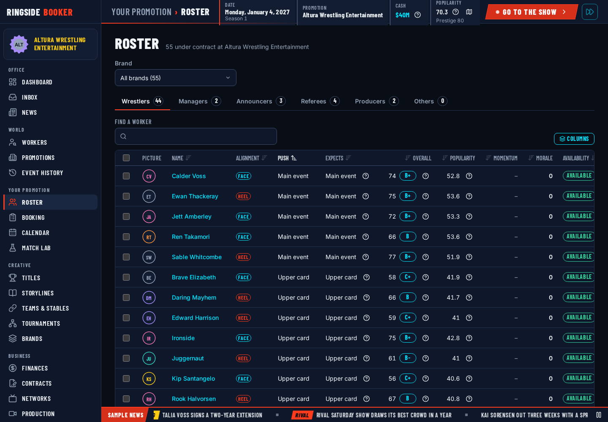
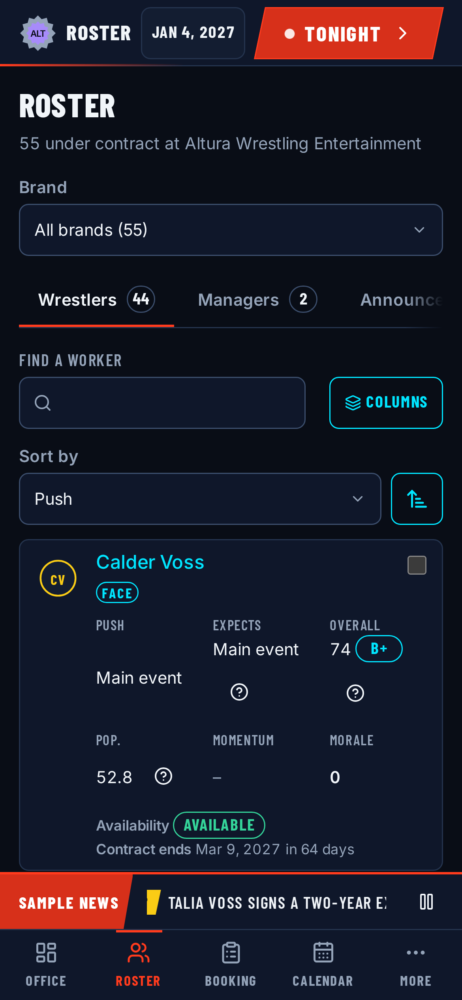

# Roster

The Roster screen is the player's own people. The `roster` system
(`packages/engine/src/systems/roster/`) answers it with one query,
`roster.rows`: every active contract with the viewer's promotion, one row each,
with every number already worked out so the screen only formats it.

The roster adds one formula of its own, the [push gap](#push-gap) and its
[verdict](#push-verdict). Everything else in a row comes from the
[workers](workers.md) system's helpers and formulas, so the roster, a profile
and the workers list can never disagree about a person.

## Roster rows

`buildRosterRows(read, promotionId, date, deps, filter)` reads the
`byPromotionStatus` index for the promotion's `active` contracts. Offers and
signed contracts that have not started belong to the contracts screens, not the
roster. A row is keyed on the employment, not the person: push, alignment,
brand, morale and momentum live on the contract, and a person can hold two
contracts with the same human (a promotion and its development territory,
D-07).

| Field                                     | Where it comes from                                                                                                                 |
| ----------------------------------------- | ----------------------------------------------------------------------------------------------------------------------------------- |
| `employmentId`, `personId`, `promotionId` | The employment row                                                                                                                  |
| `brandId`, `brandName`                    | The employment's brand and its name; both `null` for a contract on no brand (shared)                                                |
| `group`                                   | `rosterRoleGroupOf(role)`: wrestlers, managers, announcers, referees, producers, others (presenters and bookers)                    |
| `role`, `ringName`, `alignment`, `push`   | The employment row                                                                                                                  |
| `imageRef`, `gender`                      | The person row                                                                                                                      |
| `age`                                     | `ageOn(person, date)`, whole years                                                                                                  |
| `overall`                                 | `overallOf(person, role)` for the contracted role ([role ratings](workers.md#role-ratings)), to 1 decimal, and the `gradeOf` letter |
| `expectedPush`                            | `expectedPush` for the contracted role ([expected push](workers.md#expected-push)); `null` for anyone but a wrestler                |
| `pushGap`                                 | `{ steps, verdict }` from the [push gap](#push-gap) and [verdict](#push-verdict); `null` for anyone but a wrestler                  |
| `popularity`                              | `footprintPopularityValue` among this promotion's fans ([footprint](workers.md#footprint-popularity)), 0 to 100, to 1 decimal       |
| `momentum`                                | `{ value, traceRef }`: the stored momentum, `null` until the first appearance under the contract                                    |
| `morale`                                  | `{ value, traceRef }`: the stored morale                                                                                            |
| `availability`                            | `availabilityOf(person, employment, date)` as `{ status, reason, until }`; `reason` is `null` for someone simply available          |
| `endsOn`                                  | The contract's last day, `null` when open-ended                                                                                     |
| `daysLeft`                                | Days from the date to `endsOn` (`diffDays`), `null` when open-ended                                                                 |

Only wrestlers have push fields. `PUSH_LEVELS` gives crew and managers `none`,
so they have no card position to compare.

`traceRef` points at the trace the [momentum or morale door](workers.md#doors)
stored for that contract (`workers.momentum` or `workers.morale`, keyed by the
employment ID) when the trace store still holds one, and is `null` otherwise.
Overall, expected push, popularity and the push gap are derived on read and
never stored: a query cannot record traces, so their Why? is rebuilt on demand
from the same inputs.

Rows are sorted by group, then card position (main event first), then ring name
in natural order (`Test Name 5` before `Test Name 10`), then employment ID, so
the order is the same on every call.

### Filters and the view

`roster.rows` takes `{ promotionId?, brandId?, group? }`. `brandId` is a brand's
ID or `'shared'` for the contracts on no brand; `group` keeps one section. The
answer is a `RosterView`:

- `promotion`: `{ promotionId, name, brands }` with the promotion's active
  brands, flagship first, or `null` when the roster cannot be shown;
- `unavailableReason`: why there are no rows, written for the player, or `null`;
- `rows`: the rows above.

On a 300-contract roster (the screen's windowed-table threshold) building the
rows takes a few tens of milliseconds in Node.

## Push gap

How many card positions a worker sits below the push they expect:

```
push gap = position now − position expected
```

Positions count down the card from the main event: main event 0, upper card 1,
mid card 2, lower card 3, enhancement 4. A positive gap means they sit lower
than they expect, a negative one higher. A main eventer who expects the mid card
has a gap of −2; an enhancement worker who expects the main event has 4.

`computePushGap({ push, expected })` takes the expected push as WRK1's traced
`expectedPush`, so the expected push's whole Why? sits inside the gap's own
trace. The positions are fixed numbers (the order of the card), not tunables.

## Push verdict

The verdict turns the gap into the marker the roster shows:

| Gap                                | Verdict         | What the player reads          |
| ---------------------------------- | --------------- | ------------------------------ |
| `roster.expectsMoreSteps` or more  | `expectsMore`   | Expects a bigger push          |
| `−roster.expectsMoreSteps` or less | `aboveExpected` | Pushed beyond what they expect |
| Anything in between                | `asExpected`    | Where they expect to be        |

| Key                       | Kind    | Default | Range | Unit  | Meaning                                                                               |
| ------------------------- | ------- | ------- | ----- | ----- | ------------------------------------------------------------------------------------- |
| `roster.expectsMoreSteps` | integer | 1       | 1–4   | count | Card positions below (or above) the push they expect before the roster marks a worker |

The smallest value is 1 on purpose: 0 would mark every row. At 4 only the
extreme case (an enhancement worker who expects the main event, or the
reverse) is marked. `computePushVerdict(gap)` reads the tunable into its trace,
so the Why? names it.

The default world is calibrated so every wrestler starts at the push they
expect: all of Altura's wrestlers start `asExpected`.

## Viewer scoping

The roster is always the viewer's own:

- with no `promotionId`, the query takes the first promotion the viewer runs
  (`viewerPromotionIds`);
- a seat that runs no promotion (a spectator, a computer controller, the
  all-seeing viewer with no `promotionId`) gets no rows and "You don't run a
  promotion yet.";
- a controller asking for a promotion it does not run gets no rows and "You can
  only open your own roster here. Other promotions' workers are under World >
  Workers.";
- the all-seeing viewer (tools, tests, the sandbox) may read any promotion.

A query can only return data, so a refusal is data too: `promotion: null`,
`rows: []` and the reason.

Rows never carry development (potential and ceilings), vices, wages or contract
terms; the contract's end date is the only term shown. Morale is in the row
because the roster is always the viewer's own, and a rival's roster cannot be
read through this query (rivals' workers are on the [workers list](workers.md#workers-list),
which leaves morale out).

## Roster summary

`roster.summary` takes `{ promotionId?, brandId? }` and answers the counts the
roster screen's tabs and brand selector show; later features reuse it (the
Office's "Top of your roster" panel, AI planning, brand balance). It is built
from one unfiltered `roster.rows` pass (`rosterViewOf`), so it has the same
[viewer scoping](#viewer-scoping) and the same refusal texts, and its counts can
never disagree with the rows.

| Field                 | What it holds                                                                                                             |
| --------------------- | ------------------------------------------------------------------------------------------------------------------------- |
| `promotion`           | The same as `roster.rows`; `null` when the roster cannot be shown                                                         |
| `unavailableReason`   | The same reason `roster.rows` gives, or `null`                                                                            |
| `total`               | Rows counted                                                                                                              |
| `byGroup`             | Rows per group; every group is present, 0 when empty, so a screen never guesses                                           |
| `byBrand`             | `{ brandId, name, priority, total, wrestlers }` per brand, over the whole roster                                          |
| `byPush`              | Rows per card position (main event to enhancement); every position is present, 0 when empty                               |
| `unavailable`         | Rows whose availability is not `available`                                                                                |
| `unavailableByStatus` | Those rows per availability status (only the statuses that occur)                                                         |
| `expectsMore`         | Rows whose [verdict](#push-verdict) is `expectsMore`                                                                      |
| `topByPopularity`     | Up to `ROSTER_TOP_COUNT` (5) wrestlers' rows: popularity among the promotion's fans, highest first, then overall, then ID |

`byBrand` lists the promotion's active brands by priority (an empty brand
included, with 0), then any inactive brand a contract still points at, then a
final "Shared" entry (`brandId: null`, `priority: null`) when any contract is on
no brand. On a fresh default world as Altura that is Mainstage 23, Overclock 21
and Shared 11, out of 55.

With a `brandId` (a brand's ID or `'shared'`), every count except `byBrand`
covers only that brand's rows, so the tab counts follow the brand selector,
while `byBrand` still counts the whole roster so the selector shows every
brand's size. `topByPopularity` follows the filter too.

`ROSTER_TOP_COUNT` is the size of the Office roster panel: a display size, not a
balance number, so it is a constant and not a tunable.

## Roster explain

`roster.explain` takes `{ employmentId, metric }` with `metric` one of
`expectedPush`, `pushGap`, `overall` or `popularity`, and answers the Why?
behind that cell of the row: `{ employmentId, metric, label, value, unit, trace
}`, or `null`.

The rule: **derived-on-read values are explained by recomputation, stored values
by `traceRef`.** Overall, expected push, the push gap and popularity are never
stored, so their Why? is rebuilt when it is asked for. `buildRosterRows` and
`roster.explain` both start from one helper, `rowInputs(read, employment,
date)`, and run the same formulas on what it returns (`rowOverall`,
`rowExpectedPush`, `rowPushGap`, `rowPopularity`), so a cell and its Why? cannot
drift apart. The formulas are pure and roll no dice, which is what makes the
rebuilt trace exact. Momentum and morale are stored by the
[doors](workers.md#doors), so a row already carries their `traceRef`.

| Metric         | Label                                  | Value                        | Trace                                                                                   |
| -------------- | -------------------------------------- | ---------------------------- | --------------------------------------------------------------------------------------- |
| `expectedPush` | "Expects: Mid card" (the push's label) | The push, as the row has it  | [Expected push](workers.md#expected-push), with the popularity among the fans inside it |
| `pushGap`      | "Push gap"                             | The gap in card positions    | The [verdict](#push-verdict), which holds the gap's calculation and names the tunable   |
| `overall`      | "Overall as wrestler" (the role)       | The rating, to 1 decimal     | The [role rating](workers.md#role-ratings) for the contracted role                      |
| `popularity`   | "Popularity in Altura's regions"       | The popularity, to 1 decimal | [Footprint popularity](workers.md#footprint-popularity) among the promotion's fans      |

The push gap's Why? is the verdict's decision because the cell shows both the
number and the "expects more" marker: the gap's own calculation names no
tunable, and `roster.expectsMoreSteps` appears only in the verdict wrapped
around it. Every trace goes through `limitTrace` before it is returned.

The answer is `null` when the employment does not exist or is not active, when a
controller viewer does not run its promotion (the same rule as
[viewer scoping](#viewer-scoping)), or when the metric does not apply: a role
with no card position has no expected push or push gap. The all-seeing viewer
may explain any active contract.

## Set push

`roster.setPush { employmentIds, push }` is the one roster edit: it moves one
worker, or a whole selection, to one card position. The single-row menu and the
bulk action both send it; the single-row menu sends one ID. It returns
`{ changed, unchanged }`, both in ascending ID order.

| Argument        | Rule                                                                                     |
| --------------- | ---------------------------------------------------------------------------------------- |
| `employmentIds` | 1 to 300 employment IDs (300: the largest roster the DataTable is built for), no repeats |
| `push`          | A card position, or `none`                                                               |

A malformed or repeated ID, an empty list or more than 300 is `invalidArgs` on
`employmentIds`, before any row is read.

**All or nothing.** Every row is checked before anything changes. Any refused
row refuses the whole call: no row changes and no event is published. The
answer has one reason per offending row, in ascending ID order, each with
`field: 'employmentIds[<index>]'` (the row's place in the arguments) and
`subject: { kind: 'employment', id }`. Each row reports the first rule it fails:

| Code                 | When                                                                      | What the player reads                                                                  |
| -------------------- | ------------------------------------------------------------------------- | -------------------------------------------------------------------------------------- |
| `employmentNotFound` | No such contract                                                          | That contract no longer exists. Refresh the roster and try again.                      |
| `notAllowed`         | The issuer does not run the contract's promotion                          | Test Name 3 works for Test Promotion B. You can only change pushes on your own roster. |
| `contractNotActive`  | The contract is not `active` (an offer, signed but not started, or ended) | Test Name 3's contract isn't active (it is expired), so their push can't change.       |
| `pushNotForRole`     | A crew member or manager given a card position                            | Test Name 3 is a referee. Only wrestlers have a place on the card.                     |
| `pushNotForRole`     | A wrestler given `none`                                                   | Pick a card position for Test Name 3, from Main event to Enhancement.                  |

Who runs a promotion is `controlsPromotion` (`core/api/controller.ts`), which
is `sameController` on the promotion's `controller`: the same human, or the
computer for a computer-run promotion. It is the one controller rule every
command uses (AIP1-07; `finance.setPolicy` too). The AI uses this same command
for its own rosters (D-01, D-07). Brand controllers (D-06 brand wars)
are not consulted yet; a push is the promotion's call.

**Applying.** Rows go in ascending ID order. A row already at `push` is
`unchanged` and publishes nothing. Every other row goes through the workers
system's [push door](workers.md#doors) with the source `'player'` for a human
and `'ai'` for the computer and the reason key `roster.setPush`; the door
records the `workers.push` trace and publishes `employment.pushChanged`. All
rows change in the command's one transaction, so a failure part way undoes the
rows already changed. `applySetPush(ctx, args, issuedBy, door)` does the work
and takes the door as an argument so a test can make it fail.

**No direct morale effect.** The command writes the push and nothing else: no
morale, momentum, popularity or money. How a worker feels about being moved is
for the features that listen to `employment.pushChanged` (WRK8), so the story
shield for a wrestler losing as part of an angle lives in one place. While WRK8
is not built, a push change moves nothing but the push.

Like every command it is refused with `busy` while days are advancing, and
every attempt (applied, refused or failed) is in the [command log](engine-api.md#the-command-log).

### On the Roster screen

The screen sends `roster.setPush` two ways (`apps/web/src/screens/roster/`):

- **One wrestler**, from the row's menu (desktop): Set push… opens a side sheet
  with the five card positions, their current push picked and "Current" and
  "Expects" beside the matching options. Apply sends the change straight away,
  since a push is one click to undo; a refusal shows inside the sheet.
- **Several**, by ticking rows on the Wrestlers tab (crew have no push, so
  their tabs have no checkboxes): a bar above the table, or a sticky bar above
  the tab bar on a phone, opens the same sheet with how many are already at
  each position. Apply asks first ("Set 3 wrestlers to Lower card?", listing
  up to ten moves), then sends one command for all of them; a refusal keeps
  the dialog open with the engine's words and changes no row. One ticked card
  on a phone goes straight through, like the row menu.

Ticks clear when the tab or the brand changes. While days are advancing the
Set push… entries are disabled and say "Wait for the day to finish". Later
row actions (turns, brand moves, releases) append to `rosterRowActions` in
`rosterColumns.tsx`; WRK8's reaction preview goes in the sheet's `extra` slot.

## Screen

Your promotion > Roster (`apps/web/src/screens/roster/`), desktop first. The
heading carries the roster's size ("55 under contract at Altura Wrestling
Entertainment"), then the Brand selector (only for a promotion with brands:
"All brands", each brand by priority with its size, then "Shared"), the six
role tabs with their counts from `roster.summary`, and one sortable table from
`roster.rows`. The tabs always add up to the size line; a brand narrows every
tab to that brand's people.



The Wrestlers columns, and which numbers explain themselves:

| Column        | Kind                      | Why?                                                               |
| ------------- | ------------------------- | ------------------------------------------------------------------ |
| Alignment     | Stored fact               | None                                                               |
| Push          | Stored fact               | None (set by the player)                                           |
| Expects       | Derived (push gap)        | `roster.explain` `pushGap`, with the expected push folded in       |
| Overall       | Derived (role rating)     | `roster.explain` `overall`, attribute lines and `workers.rating.*` |
| Popularity    | Derived (fan roll-up)     | `roster.explain` `popularity`, region by region                    |
| Momentum      | Stored by its door        | The stored trace when there is one; "–" before a first appearance  |
| Morale        | Stored by its door        | The stored trace when there is one                                 |
| Availability  | Stored status with reason | None; the reason is in the chip's words                            |
| Contract ends | Stored date               | None                                                               |

On a phone the table becomes cards (six stats each), the tab strip scrolls
sideways inside itself, the Brand selector spans the width, ticking a card
shows a bar stuck above the tab bar, and Set push opens as a bottom sheet.



The Office shows **Top of your roster** (side column, order 30): the five
`topByPopularity` wrestlers with push, popularity (with its Why?) and
momentum, each linking to the profile, and "View roster". The e2e
`apps/web/e2e/roster.spec.ts` covers the counts, the brand filter, the three
Why? panels, single and bulk Set push, persistence through Main menu and
Continue, and the layout on desktop, phone and phone WebKit.
