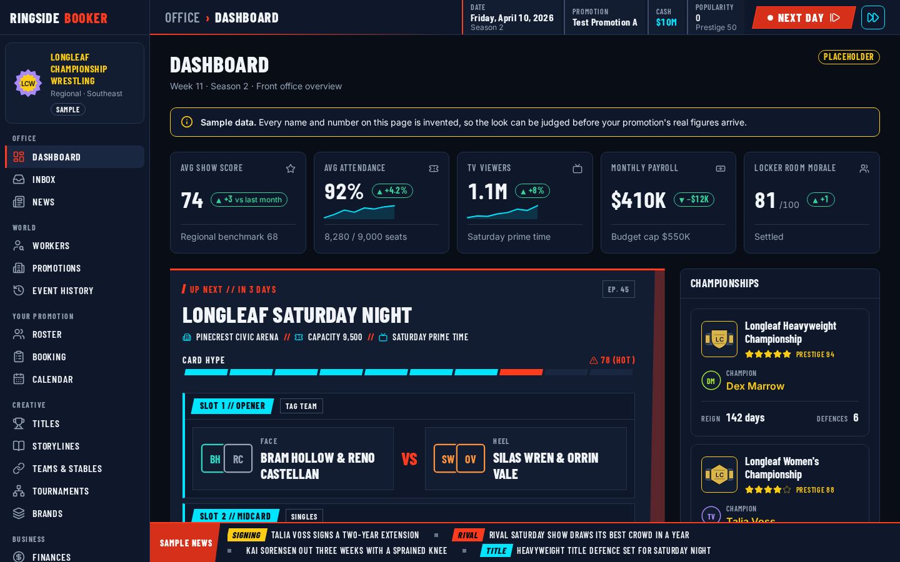
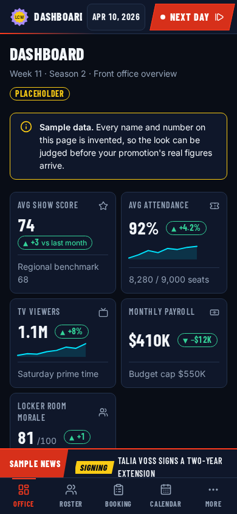
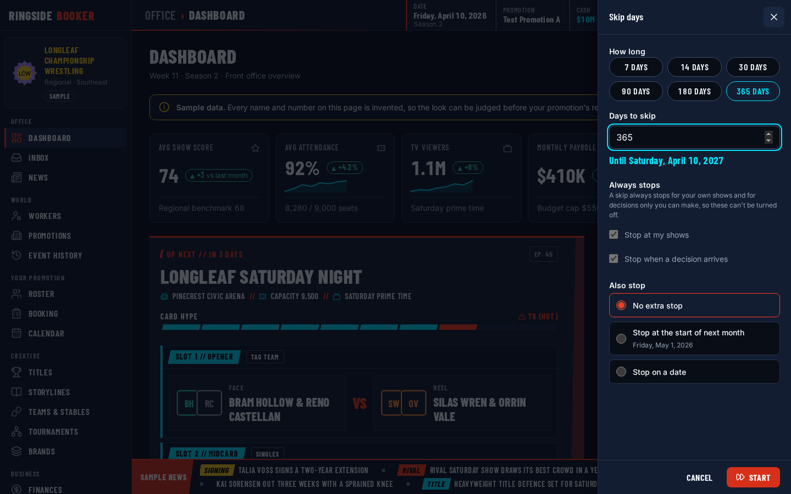
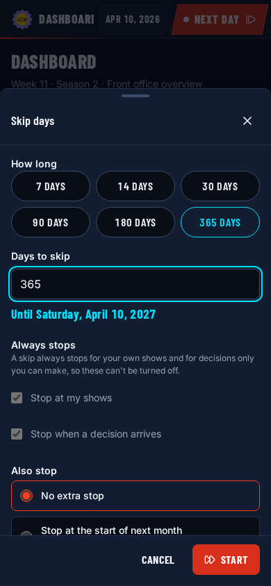
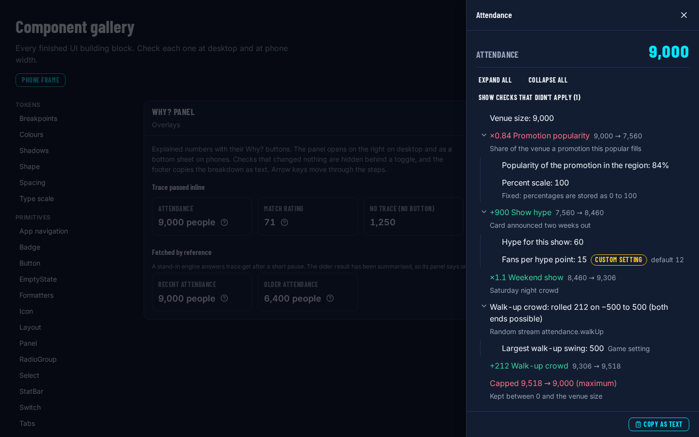
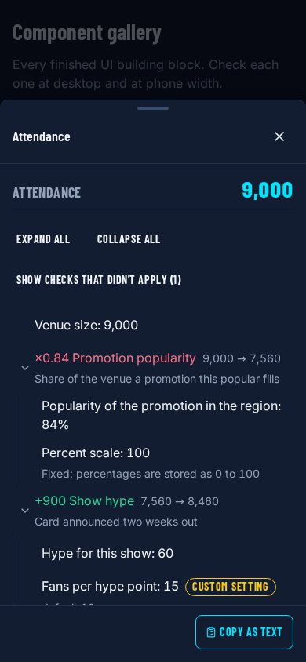

# App shell: a game UI that keeps the engine at arm's length

## Summary

The App shell and UI epic is done. The game now has a real front end: a Vite and React app with
clean URLs, a dark design system, a set of primitives and a table that turns into cards on a phone,
generated placeholder art, and a shell with a sidebar on desktop and a tab bar on phones. The engine
runs in a Web Worker behind a small query cache, and the worker decides who the local player is, so
no screen ever passes a viewer or a controller. On top of that sit the Why? panel, the top bar's
status and the Next Day and Skip days controls, the title and saved games screens, and a settings
screen. Every screen is checked at 1440 pixels and at 390 pixels by Playwright.

## What I built

- **UI-01: The web app workspace.** Vite 5, React 18 and React Router 6 in `apps/web`, TypeScript
  strict, Vitest with jsdom, and lint rules that ban inline styles, imports from engine internals
  and the engine's test fixtures in app code. A lint self-test keeps the rules from quietly
  disappearing. `apps/web/vite.config.ts`, `apps/web/src/main.tsx`, `apps/web/src/app/router.tsx`,
  `apps/web/src/test/lint-guards.test.ts`, `eslint.config.js`
- **UI-02: Playwright harness.** A desktop project at 1440×900, a phone project at 390×844 with
  touch, and a WebKit phone project that runs on pushes to main. Every test fails on a console
  error, and helpers check for horizontal scroll (naming the widest element) and serious axe
  issues. `apps/web/playwright.config.ts`, `apps/web/e2e/fixtures.ts`,
  `apps/web/e2e/helpers/layout.ts`, `apps/web/e2e/helpers/a11y.ts`, `.github/workflows/ci.yml`
- **UI-03: Design tokens.** Colour, spacing, type, motion and layout tokens as CSS custom
  properties, one breakpoint shared by CSS and TypeScript with a test that fails if they drift, a
  contrast test that parses `tokens.css`, a UI scale and reduced motion. `apps/web/src/styles/`,
  `docs/design/ui-tokens.md`
- **UI-04: Core primitives and formatters.** Button, IconButton, Icon, Panel, Badge, CountBadge,
  StatBar, EmptyState, Stack and Cluster, plus money, number, percent, signed and game-date
  formatters that never shift a date in any time zone. `apps/web/src/components/`,
  `apps/web/src/components/format/format.ts`
- **UI-05: DataTable.** A sortable table on desktop and a list of cards on phones from one set of
  column definitions, with a stable sort (ties broken by id, nulls always last), keyboard
  selection, a "Sort by" control for the cards, and empty and loading states.
  `apps/web/src/components/DataTable/`
- **UI-06: ImageSlot and placeholder art.** Initials and silhouettes for people, belts for titles,
  logo marks for promotions and the rest, all picked by hashing the entity id, plus a resolver
  registry so a future image pack can swap in real pictures without touching a screen.
  `apps/web/src/components/ImageSlot/`, `docs/design/ui-tokens.md#placeholder-art`
- **UI-07: App shell, routes and navigation.** Every URL as a typed builder, the navigation as
  data, a sidebar and top bar on desktop, a tab bar and More sheet on phones, sections that hide
  while you have no promotion, focus moved to the heading after each navigation, and a not-found
  screen. `apps/web/src/app/routes.ts`, `apps/web/src/app/navigation.ts`,
  `apps/web/src/app/AppShell/`, `apps/web/src/app/a11y/`, `apps/web/src/app/README.md`
- **UI-08: The engine worker and its hooks.** The engine host inside a Web Worker behind Comlink,
  the local seat worked out in the worker and injected into every call, an in-process transport
  for tests, and the React side: the provider, the revision-keyed query cache, `useEngineQuery`,
  `useEngineCommand`, `useAdvanceDays` and `useEngineStatus`. A lint rule keeps `createEngine`
  inside `src/worker`. `apps/web/src/worker/engineHost.ts`, `apps/web/src/worker/localViewer.ts`,
  `apps/web/src/worker/engine.worker.ts`, `apps/web/src/app/engine/`
- **UI-09: The Why? panel.** A row for every kind of trace step, dispatched with an exhaustive
  switch so a new step kind in the engine fails the web typecheck, a tree you can walk with the
  arrow keys, "Show checks that didn't apply", copy as text, and `Explained`, the one component a
  screen needs to show a number with its Why? button. It opens on the right on desktop and as a
  bottom sheet on phones. `apps/web/src/components/Trace/`
- **UI-10: Top bar status and moving time.** Date, season, cash and popularity chips from the
  engine's built-in `sim.status`, the day button that turns into "Go to show" or "2 decisions
  waiting" from `sim.pendingGates`, the Skip days sheet, a progress overlay with Stop, a summary
  after each advance, autosave, Shift+N, and a registry so later systems can add their own chips.
  `apps/web/src/app/AppShell/day/`, `apps/web/src/app/AppShell/status/`
- **UI-11: Title screen and saved games.** Load, save, autosave and unload run inside the worker,
  so a save's bytes never cross to the main thread. Import, export, backups, delete, and a sheet
  that shows the stage a bad save failed at and the paths it tripped on. The e2e suite builds a
  sample save from the engine's golden fixture and plays through it.
  `apps/web/src/screens/title/`, `apps/web/src/screens/saves/`,
  `apps/web/e2e/fixtures/build-sample-save.ts`
- **UI-12: Settings.** UI scale, reduced motion and money style, stored per device and applied to
  `<html>`, with a schema that keeps the valid fields of a half-broken stored value.
  `apps/web/src/app/settings/`, `apps/web/src/screens/settings/`
- **UI-13: Tabs, Sheet and ConfirmDialog.** WAI-ARIA tabs with a strip that scrolls sideways on a
  phone, and a sheet and a confirm dialog on the native `<dialog>` element with a counted scroll
  lock, so a confirm opened from a sheet keeps the page locked until both close.
  `apps/web/src/components/Tabs/`, `apps/web/src/components/Sheet/`,
  `apps/web/src/components/ConfirmDialog/`
- **UI-14: This entry.** The screenshots under `docs/blog/images/app-shell/` and the numbers
  below.
- **UI-15: Component gallery.** `/dev/gallery` collects every `*.gallery.tsx` file under
  `entries/`, checks their ids, reads the tokens straight from `tokens.css`, and shows each entry
  in a real 390px frame next to the desktop view. The e2e suite opens every entry on both
  projects. `apps/web/src/screens/dev-gallery/`

## Decisions and why

### The browser router with clean URLs, and an SPA fallback on the host

- **Decision:** `createBrowserRouter` with real paths such as `/game/office`, every path built
  from `routes.ts`. In production the app will sit on S3 behind CloudFront with the usual
  single-page fallback: a 403 or 404 from the bucket serves `/index.html` with a 200, so a reload
  on `/game/roster` or a shared link opens the app, `RequireWorld` sends you to the title screen
  when no game is loaded, and anything unknown reaches the not-found screen. `vite preview` does
  the same thing locally, which is what the e2e suite runs against.
- **Alternatives:** A hash router (`/#/game/office`), which works on any static host with no
  configuration; a pre-rendered `index.html` per route.
- **Why:** Hash URLs work, but they look like a workaround, and they get in the way of real
  in-page anchors (the gallery deep-links to entries by hash). The fallback is two lines of
  hosting config that I already use on my other sites, and the app isn't built to be crawled, so
  pre-rendering buys nothing. The site isn't deployed yet; this is the plan the code assumes.
- **Revisit if:** The game has to live under a sub-path (then Vite's `base` and the router's
  `basename` change together), or it ends up on a host that can't rewrite missing paths.

### The engine in a Web Worker, behind a revision-keyed cache

- **Decision:** The engine runs in a Web Worker and the page talks to it through Comlink. Every
  query result carries the world revision it was computed at. Every applied command and every
  simulated day raises the revision, and a cached result older than the latest revision is stale:
  mounted queries refetch and keep showing the old data meanwhile. The cache is about 150 lines
  of our own code, keyed by query name and sorted arguments, with shared in-flight requests and a
  200-entry limit.
- **Alternatives:** Running the engine on the main thread; a general data-fetching library with
  query keys and invalidation rules per query.
- **Why:** A ten-year skip on the main thread would freeze the page, and the engine already yields
  between days, so the worker costs little. For freshness, a data-fetching library is built for
  servers whose data changes behind your back, so it brings time-based staleness, retries and
  focus refetching. Our data only changes when the engine says so, and the engine says so with one
  integer. "Stale when the revision moved" is a rule a small cache can follow exactly, and nobody
  has to remember which queries a command invalidates.
- **Revisit if:** Refetching every mounted query after each day becomes measurable during long
  skips, at which point the engine could report which tables a day touched.

### The worker resolves the local seat and injects `viewer` and `issuedBy` (D-07)

- **Decision:** When a world is installed, the worker's host works out the local seat from the
  promotion and brand controllers (`resolveLocalViewer`) and passes that viewer into every query
  and that controller into every command. Screens and hooks never see either. A save with no human
  controller gets an observer seat with no promotion.
- **Alternatives:** A React context holding the viewer that every hook reads and passes along.
- **Why:** D-07 makes viewers and controllers part of every engine call. If screens passed them,
  every screen would be a place to pass the wrong one, and multiplayer would have to touch all of
  them. With the worker holding the seat, picking a seat is one function, and in multiplayer the
  server assigns it instead.
- **Revisit if:** One device needs to act for two seats, such as hot-seat play, or a screen needs
  to look at the world as another controller.

### The shell reads the engine's `sim.status` and `sim.pendingGates`

- **Decision:** The top bar's date, season, cash and popularity come from `sim.status`, and the
  day button's state from `sim.pendingGates`. Both are built into the engine (SIM-10). The web
  app defines no engine queries of its own; if a field is missing, it gets added in the engine.
- **Alternatives:** A UI-owned "shell summary" query that gathers exactly what the top bar shows.
- **Why:** `sim.pendingGates` calls the same read-only gate check the advance loop uses, so the
  button can't say "Next day" while the skip would stop straight away. A UI-owned query would also
  have to come back for the headless runner and the future server, and every new screen would be
  tempted to add one. Keeping queries in the engine keeps the engine API the one surface.
- **Revisit if:** The shell needs something that mixes several systems and isn't really a `sim`
  concern, such as a news count; then that system ships the query and registers a chip.

### One breakpoint, and a DataTable that renders cards as different markup

- **Decision:** One breakpoint, `--bp-mobile` (below 48rem), in both CSS and TypeScript, with a
  test that fails if the two disagree. Below it, the DataTable renders a list of cards: a
  different DOM built from the same column definitions, each column declaring its card role
  (media, title, subtitle, stat, meta or hidden).
- **Alternatives:** Several breakpoints for tablets and wide screens; one `<table>` restyled with
  CSS into cards.
- **Why:** Every screen has two layouts to design and test, and the Playwright projects check
  exactly those two widths. A third would be a third layout nobody tests. A table restyled as
  cards keeps table semantics that make no sense in a card, and it can't reorder or regroup cells
  without fighting the markup. Separate markup lets the cards be a real list with the right
  roles, and the column definitions keep the two from disagreeing about the data.
- **Revisit if:** Tablet players report a layout that is cramped in a way a fluid layout can't fix.

### Placeholder art from a hash of the entity id

- **Decision:** Placeholder colours and shapes come from FNV-1a over the entity id, re-hashed with
  a salt for each choice. They never draw from the engine's RNG streams.
- **Alternatives:** Picking art from a seeded engine stream; storing an art choice on each entity.
- **Why:** Art is presentation. If it drew from the engine, adding a new belt shape would move
  every later roll on that stream and change game results, which breaks the rule that only the
  thing you changed moves. Storing a choice per entity would put presentation in saves. Hashing
  the id is stable across reloads and browsers, and a renamed wrestler keeps their colours.
- **Revisit if:** Real art packs make placeholders rare enough that they stop mattering.

### Viewer preferences live in `localStorage`, never in saves

- **Decision:** UI scale, reduced motion and money style are stored per device under one
  `localStorage` key and applied to `<html>`. They are never written into a save. A damaged value
  keeps its valid fields and defaults the rest.
- **Alternatives:** Storing settings in the save; storing them in IndexedDB next to the save
  slots.
- **Why:** These are about the screen in front of you, not the game. A phone wants a different
  scale from a desktop, and an exported save shouldn't carry the text size of the machine it came
  from. `localStorage` is synchronous, so the settings apply before the first paint and the page
  doesn't flash at the wrong size.
- **Revisit if:** Players want settings to follow them between devices, which would need accounts.

## How this differs from other games in the genre

- The whole game is meant to work on a phone as well as a desktop browser, and both layouts are
  tested on every pull request, not checked by hand once.
- Long skips run off the main thread with a live progress bar and a Stop button that always lands
  on a whole day, so the page never freezes while the world moves.
- Any number backed by a trace gets a Why? button, and the panel shows the working step by step,
  including the random rolls and any custom settings, and copies it as text for a bug report.
- The day button tells you why it won't advance ("2 decisions waiting", "Go to show") instead of
  failing when you press it.
- Saves stay on your device and can be exported to a file and opened on another one, and a save
  that won't load says exactly which check it failed.

## Numbers

- **Unit tests:** 1,466 Vitest tests in 97 files in `apps/web`, from `npx vitest run` in the
  workspace at `e61de75`.
- **End-to-end tests:** 14 Playwright spec files × 2 projects (desktop at 1440×900, phone at
  390×844) = 238 test runs: 202 passed and 36 skipped where a test only applies to one width, in
  1.1 minutes on my machine. On pushes to main a third project, WebKit at phone size, makes it 357.
  These counts include the specs other epics added to the same suite (the new-game wizard and the
  broadcast and office styling).
- **Bundle size:** from `npm run build` in `apps/web`.

  | Chunk                                | Minified | Gzipped  |
  | ------------------------------------ | -------- | -------- |
  | Main (`index-*.js`)                  | 1,014 kB | 317.8 kB |
  | Engine worker (`engine.worker-*.js`) | 354 kB   | 108.4 kB |
  | Styles (`index-*.css`)               | 155 kB   | 24.6 kB  |
  | Bundled world data (27 chunks)       | 775 kB   | 144.4 kB |

  The world data came with the new-game wizard, not this epic. Its chunks are fetched by the
  worker only when the wizard asks for the bundled packs.

- **A 365-day skip of the sample save:** 20 to 31 ms in headless Chromium from pressing Start to
  the summary appearing, five runs each on the desktop and phone projects (desktop 23, 24, 24, 31
  and 23 ms; phone 20, 24, 22, 24 and 20 ms) on my machine (Intel i5-13600KF, WSL2). The sample
  world has 16 people and two promotions, and only the `sim` and fatigue systems run, so this
  measures the worker round trip and the shell more than the simulation.
- **Save size:** the sample save is 4,117 bytes as a gzipped `.rbsave`.

## What went wrong or surprised me

- **The no-scroll check passed with the page overflowing.** My first `expectNoHorizontalScroll`
  compared `scrollWidth` with `innerWidth`. In Chromium's phone emulation a 600px box stretched
  `innerWidth` to 608, so the check passed while the page scrolled sideways. It now compares with
  `documentElement.clientWidth` and names the element that sticks out.
- **WebKit wouldn't run on my machine.** It needs system libraries I can't install here, so the
  iPhone-engine project only runs on CI, on pushes to main. That's the browser most phone players
  will use, and it's the one I see least.
- **Accessibility caught real things.** axe flagged `aria-activedescendant` on a `<tbody>` as
  critical, so the DataTable's grid role moved to the `<table>`. A loading button hidden with
  `visibility` lost its accessible name, so it uses opacity. A tap on the strip around a bottom
  sheet's drag handle counted as a backdrop click and closed the sheet.
- **Small visual bugs that only show in use.** The StatBar's gain tint was the same green as a
  high value and vanished above 70. Buttons stayed highlighted after a tap on touch screens until
  hover styles moved behind `(hover: hover)`. One light-theme placeholder colour was 4.30:1 under
  white initials, short of 4.5.
- **Two invented gallery names were too close to real ring names** and got renamed. A good reason
  to keep every fixture name obviously made up.
- **D-11 arrived halfway through.** The visual identity decision made the game dark only and
  changed the phone tab bar to Office, Roster, Booking, Calendar and More. Settings hides its theme
  choice but keeps the plumbing, so a light theme can come back without a rewrite.
- **Comlink's types drop generics.** A remote `query<K>` loses its `K`, so the worker transport
  has one narrow cast to keep queries and commands typed end to end.
- **The golden save couldn't load as it was.** Its simulation parts were placeholders the engine's
  schemas reject, so the e2e sample save and the test helper keep the golden world and fill those
  parts from a fresh engine state.
- **The sample world is too fast to watch.** It runs ten years in well under a second, so the e2e
  test records the progress overlay's layout from inside the page the moment it opens, rather than
  trying to catch it.
- **The main chunk is a megabyte.** About 137 kB of it is engine code (entity schemas, world and
  pack loading), because the engine package doesn't mark itself free of side effects; zod is in
  both the main chunk and the worker; and the component gallery, which ships in every build, is
  about 105 kB. None of that is urgent at this size, but it's the first thing to look at when load
  time matters.
- **Things writing this entry turned up.** On a 390px phone the top bar cuts "Dashboard" off
  mid-letter instead of with an ellipsis. The sidebar's crest still shows the sample promotion
  while the top bar shows the loaded one. And no number in the shell has a trace yet:
  `sim.status` returns no trace for popularity, so the Why? panel below is the gallery's
  example, not one opened from the sample save. Those go on the board rather than into this entry.
- **One flaky unit test.** "Main menu is disabled while days are advancing" failed once in a full
  run and passed every time on its own. It goes on the board too.
- **Better than expected:** keeping the engine behind one worker and one revision number made
  the save screens, the day control and the Why? panel almost independent of each other. Each one
  only had to ask the engine and trust the revision.

## Open questions

- **Brand-only seats.** If a human runs a brand but not its promotion, the worker gives the seat
  the promotion that owns the brand, while the engine's `viewerPromotionIds` returns nothing for
  that viewer. A test pins the difference down. Brand wars will have to settle which one is right.
- **When to split the main chunk.** The gallery and the engine's schemas are easy wins, but I
  don't know yet whether first load on a phone matters more than one less request.
- **What the top bar shows when it's busy.** The phone bar has no room for "Saving…", so it only
  shows in the status sheet. Fine for now; less fine if autosaves get slow.
- **Real-phone checks.** Export and import go through the share sheet and the file picker, which
  emulation can't test. I still need to try both on an actual phone.

## Blog angle

This entry feeds two planned posts and suggests a third, for readers who build web apps but
haven't built a game in one:

- **Part 04, "Every number explains itself: the Why? panel".** The simulation entry has the trace
  side; this one adds the panel, the row per step kind, and the exhaustive switch that makes a new
  kind of step a type error in the UI.
- **Part 06, "A desktop game that fits on a phone".** One breakpoint, the table that becomes cards,
  sheets on phones and panels on desktop, and the two Playwright projects that check every screen
  at both widths, with the screenshots above.
- **A new part 08, "A sim in a Web Worker".** Why the engine runs off the main thread, why one
  revision number replaced a data-fetching library, and why the worker, not the screens, decides
  who the player is.

## Raw notes

Nothing this time. The inbox had no UI notes when I wrote this.

## Next

- **The first real screens.** Roster, booking and calendar replace their placeholders through
  `navigation.ts`, using the DataTable, ImageSlot and `Explained`, and the office's sample
  dashboard goes once real numbers exist.
- **Traces in the shell.** Once popularity is a real calculation, `sim.status` can return its
  trace reference and the top bar's popularity gets its Why? button.
- **Deploying.** The S3 and CloudFront hosting with the SPA fallback, so the game has a public
  address.
- **The three follow-ups above:** the clipped phone title, the sample crest in the sidebar, and
  the flaky Main menu test.
