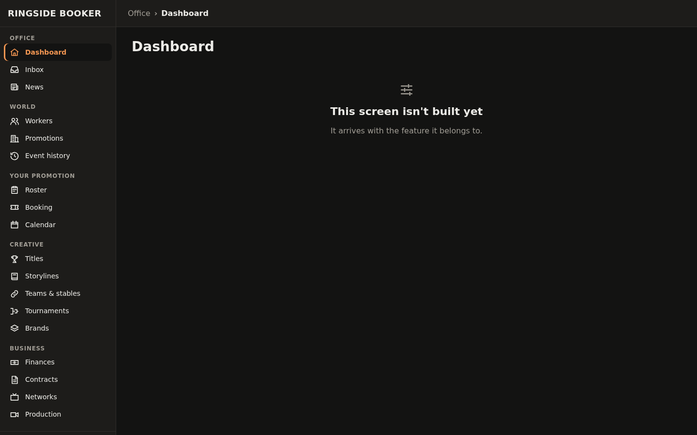
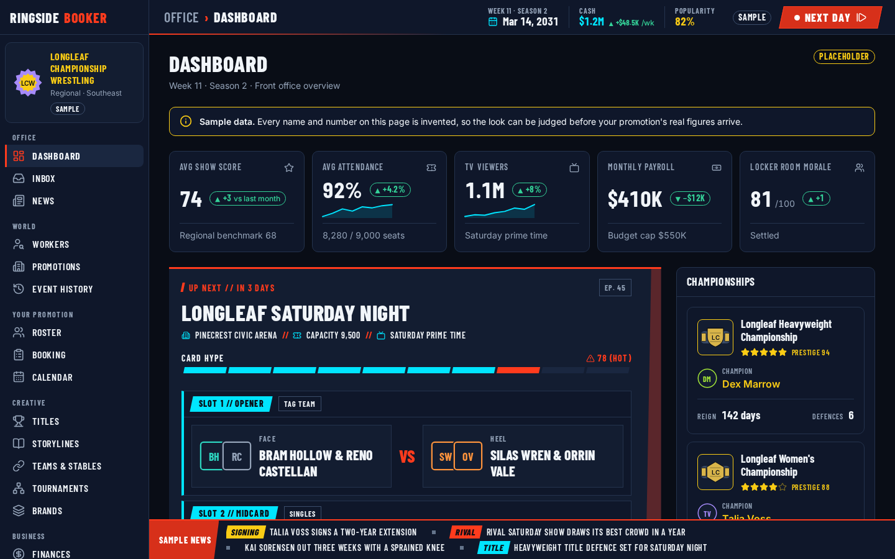
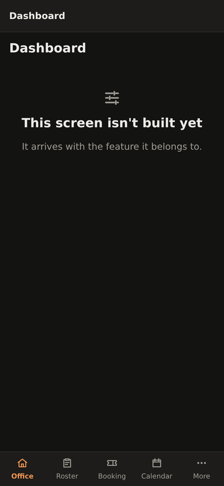
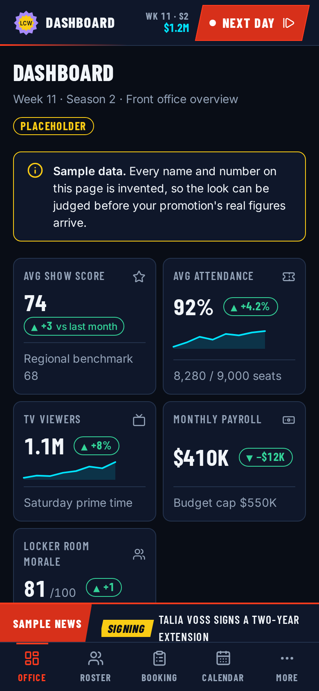
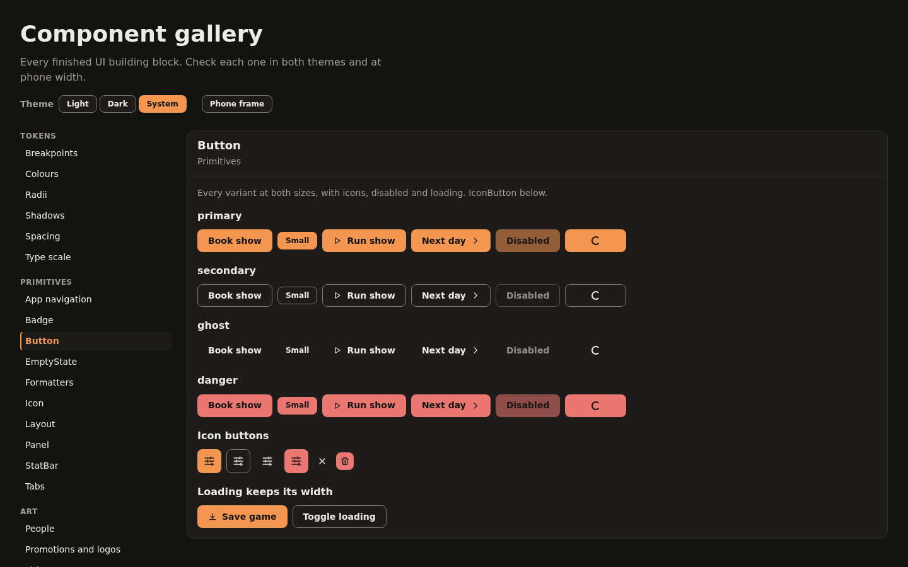
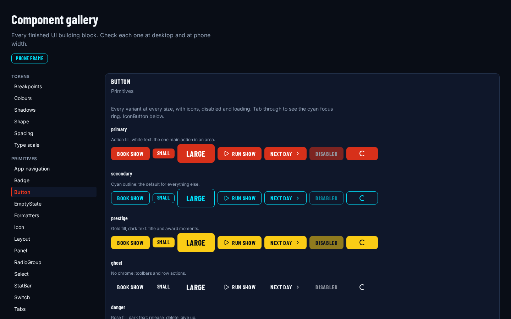
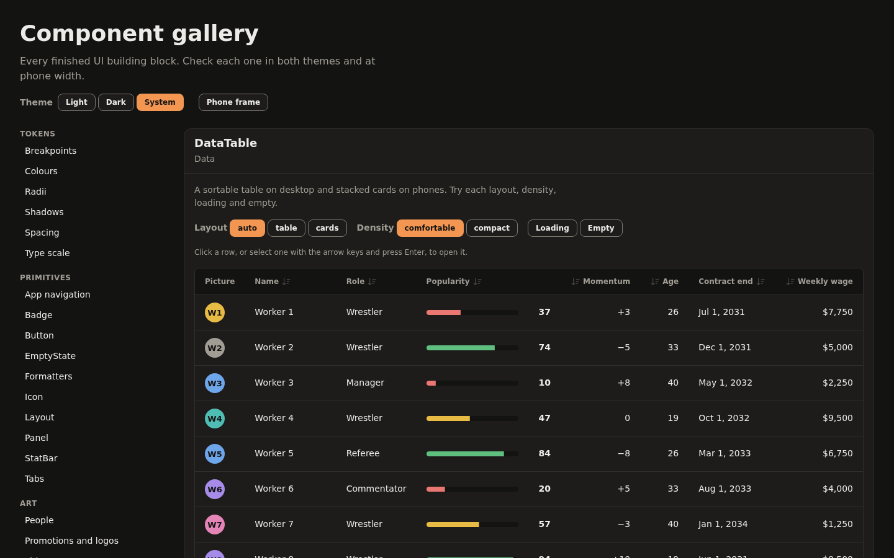
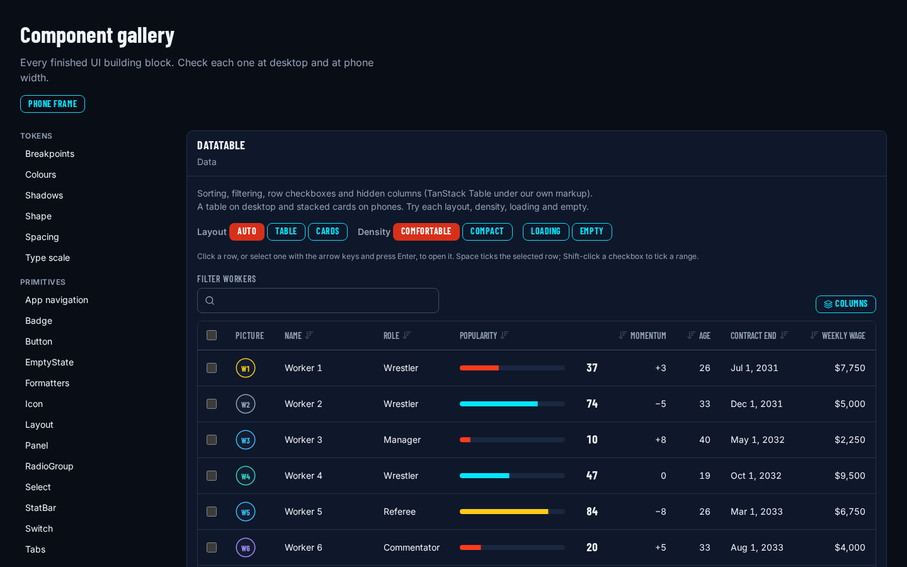

# Visual identity: office by day, broadcast by night

## Summary

The game has a look now. Before this epic the UI was a tidy but generic app: a system font, a
burnt-orange accent, and light and dark themes that followed the OS. Now it has two registers
that share one palette and one type system (D-11): a calm front-office look for the management
screens, and a sports-broadcast look (condensed capitals, skewed bugs, chamfered panels, a live
red-orange) for the moments that should feel like TV. The theme is dark only for now. The
interactive pieces moved onto Radix UI, TanStack Table and Lucide, styled with our own tokens, and
two component kits (broadcast and office) give later screens something to build from. The shell
wears the new look, the office shows a clearly labelled sample dashboard built from the kits, and
an accessibility pass checked all of it in the running app at desktop and phone width.

## What I built

- **VIS-01: Dark broadcast tokens and fonts.** I replaced every palette primitive with a navy,
  red-orange, cyan, gold, emerald, rose and violet set, mapped every semantic role from the
  visual identity onto them, and removed the light and OS-following theme blocks. Older semantic
  names still work and point at the new roles (accent is action-bright, info and focus are data,
  warning is prestige). Barlow Condensed and Inter are self-hosted, with display and UI family
  tokens, a `.tabular` helper, and shape, glow and pulse tokens. `theme.ts` keeps its API and
  learns which themes ship. Contrast tests cover every text role on the canvas, surface and raised
  surface. `apps/web/src/styles/tokens.css`, `styles/theme.ts`, `styles/tokens.test.ts`,
  `docs/design/ui-tokens.md`
- **VIS-02: Radix for the interactive primitives.** Tabs, Sheet and ConfirmDialog were rebuilt on
  Radix with their public props unchanged, and new Tooltip, Popover, DropdownMenu, Select and
  Switch wrappers joined them. A shared `useOverlayFocus` hook replaced my hand-written modal
  focus code: it remembers what opened an overlay and gives focus back on close. A Playwright spec
  opens and closes every overlay on desktop and phone. `components/Sheet/useOverlayFocus.ts`,
  `components/{Tabs,Sheet,ConfirmDialog,Tooltip,Popover,DropdownMenu,Select,Switch}/`,
  `apps/web/e2e/overlays.spec.ts`
- **VIS-03: DataTable on TanStack Table.** Sorting, the filter box, row checkboxes and hidden
  columns run on TanStack Table 9, with our markup and styling on top. The old props still work,
  and the table gains `sortable`, `initialSort`, `filterable`, `selectable` and `columnPicker`.
  Ties still break by row id and empty values still sort last, through a hidden row-id column
  used as the last sort key. Phones keep the stacked cards. `rowWindow.ts` is the hook point for
  windowing 300-row rosters later. `components/DataTable/`, `apps/web/e2e/data-table.spec.ts`
- **VIS-04: Lucide icons behind the Icon component.** Screens still ask for an icon by name.
  The props now demand either a `label` or `decorative`, so an icon with neither doesn't compile,
  and a lint guard keeps `lucide-react` imports inside the Icon component as named imports, so
  only mapped glyphs reach the bundle. `components/Icon/`, `eslint.config.js`,
  `src/test/lint-guards.test.ts`
- **VIS-05: The broadcast kit.** `LiveBugButton`, `LowerThird`, `ScoreBug`, `Ticker`,
  `SegmentedMeter`, `CardSlot`, `ChamferPanel` and `SlashDivider`, each with a CSS Module, tests
  and a gallery entry, plus a `useReducedMotion` hook that reads both the device setting and the
  in-game one. The ticker has a pause button, and the meter adds an icon and a word in its danger
  zone. `components/{LiveBugButton,LowerThird,ScoreBug,Ticker,SegmentedMeter,CardSlot,ChamferPanel,SlashDivider}/`,
  `styles/useReducedMotion.ts`, `apps/web/e2e/broadcast.spec.ts`
- **VIS-06: The office kit.** `KpiCard` with `KpiCardGrid`, `DeltaChip`, an inline-SVG
  `Sparkline`, `AlignmentChip`, and `ChampionCard` with `ChampionCardList`. KPI cards go two-up on
  a phone and champion cards become a swipe row. People placeholders became ringed initials in
  their category colour, and DataTable picked up the stat-table look and an optional `striped`
  prop. `components/{KpiCard,DeltaChip,Sparkline,AlignmentChip,ChampionCard}/`,
  `components/ImageSlot/`, `apps/web/e2e/office.spec.ts`
- **VIS-07: The existing primitives in the new identity.** Button (action fill, cyan-outline
  secondary, gold prestige, ghost, rose danger, three sizes, 44px targets on phones), Panel
  (rounded office card plus a chamfered broadcast variant), Badge, StatBar and EmptyState. Tones
  are now the colour roles, and the old tone names still draw as their role, so no screen needed
  a code change. A stylesheet test pins the rules that carry the identity.
  `components/{Button,Panel,Badge,StatBar,EmptyState}/`, `components/tone.ts`,
  `components/primitivesCss.test.ts`
- **VIS-08: The shell and a sample office.** The sidebar got the wordmark, a promotion crest block
  and a red-orange rail on the current item. The top bar got a status strip (week, season, date,
  cash with its weekly change, popularity) and the live Next Day bug. The news ticker runs along
  the bottom and rides above the tab bar on phones. The office is a placeholder dashboard built
  only from the kits, with invented figures and a banner, a badge and chips that say so.
  `app/AppShell/`, `screens/office/`, `apps/web/e2e/shell-identity.spec.ts`
- **VIS-09: Accessibility and motion in the running app.** The axe helper now runs the WCAG 2.1
  and 2.2 A and AA rules as well as 2.0. A new spec walks every Tab stop in the gallery, the shell,
  the More sheet and open menus and checks each focus ring's width, its contrast in place, whether
  anything clips it and whether a fixed bar hides it. `motion.test.ts` holds every stylesheet to
  the motion tokens and the reduced-motion rules. The fixes it led to are listed under what went
  wrong. `apps/web/e2e/accessibility.spec.ts`, `e2e/helpers/focus.ts`, `styles/motion.test.ts`,
  `docs/design/visual-identity.md#accessibility`

Paths starting with `components/`, `app/`, `screens/`, `styles/` or `src/` are under
`apps/web/src/`. The visual identity guide, D-11 and the design mockups landed just before the
epic started (`docs/design/visual-identity.md`, `docs/design/mockups/`).

### Before and after

The office screen didn't exist before this epic, so the first pair is mostly a new screen, not a
restyle. The gallery pairs show the same components before and after. All the "before" shots use
the old dark theme, so the comparison is about the identity, not light against dark.

| Phone, before                                                                                                                    | Phone, after                                                                                                                                                                 |
| -------------------------------------------------------------------------------------------------------------------------------- | ---------------------------------------------------------------------------------------------------------------------------------------------------------------------------- |
|  |  |

## Decisions and why

### Two registers instead of one look (D-11)

- **Decision:** One palette and one type system, worn two ways. The office register (rounded
  cards, sentence-case Inter, clear tables) covers roster, contracts, money, inbox and the rest of
  the management screens. The broadcast register (Barlow Condensed in capitals, skews, chamfers,
  lower-thirds, glows) covers booking, show night, title changes, drafts and the Next Day control.
- **Alternatives:** I had two full mockup sets side by side, one all front office and one all
  broadcast. Either one on its own was the obvious choice.
- **Why:** The all-broadcast dashboard was exciting for about a minute. Condensed capitals and
  monospaced figures on every line are tiring to read for an hour of contract work, and when every
  panel shouts, nothing stands out. The all-office set was easy on the eyes, but it looked like any
  business dashboard, and a show is supposed to feel like a show. The game is mostly management
  with live moments in between, so the UI should change gear when the game does. Keeping one
  palette and one type system means the two registers read as one product, and the dashboard can
  mix them: office cards around a broadcast "Up next" card and a live Next Day bug.
- **Revisit if:** Players can't tell why one screen looks different from another, or the
  broadcast register starts leaking into management screens because it looks cooler.

### Dark only, with the theme layer kept

- **Decision:** Ship one dark theme. The light and OS-following blocks are gone, but
  `[data-theme]`, the theme preference and `applyTheme` stay, so a light theme is one CSS block
  away.
- **Alternatives:** Re-theme both light and dark; keep following the OS.
- **Why:** The broadcast look depends on light on dark: glows, a live dot, a ticker. A light
  version would need its own contrast checks for every role and its own answer to "what does a
  glow look like on white". That's twice the tuning before a single real screen exists. The
  arena with the house lights down is the mood I want anyway.
- **Revisit if:** People ask for a light theme for long sessions in daylight, which I'd expect
  sooner or later.

### Every colour has one job

- **Decision:** Navy neutrals that sit near cyan's hue, one warm red-orange for "act now / this is
  live", cyan for data, links and focus, and gold for prestige. Rising and falling numbers get
  emerald and rose, not the action colour. Face, heel and tweener reuse cyan, red-orange and
  violet, and every coloured state also has an icon, a sign or a word.
- **Alternatives:** Keeping the burnt orange; red and green for deltas; a gold accent.
- **Why:** The red-orange is close to the complement of cyan, so against a cool field it is the
  one thing that pops. That only works if it is rare, so I aim for roughly 60% navy, 30% text and
  borders and 10% accent. If a screen looks busy, there's too much accent. Gold is the
  red-orange's calmer, lighter neighbour, which suits titles: important, not urgent. Rose for
  "this dropped" keeps it from ever reading as "press this", and it's the reason StatBar changed
  its bands to red-orange for weak, cyan for the middle and gold for elite, as the DataTable pair
  above shows. The "never colour alone" rule is why the meter puts a warning icon and a word in its
  danger zone and why delta chips carry ▲ and ▼.
- **Revisit if:** The 10% creeps up as real screens land. The first sign will be screens where the
  red-orange appears more than once.

### Two self-hosted fonts with separate jobs

- **Decision:** Barlow Condensed (600 to 800) for display, labels, chips and big numbers; Inter
  (400 to 600) for body text, tables and forms. Both are self-hosted, and numbers in tables and
  stats always use tabular figures.
- **Alternatives:** One family for everything; loading fonts from a CDN.
- **Why:** The condensed face is what makes the broadcast register look like TV graphics, but it
  is hard work for paragraphs. Inter is easy to read at small sizes. Self-hosting keeps the game
  working offline and makes no requests to anyone else's servers. Tabular figures stop columns of
  numbers wobbling as they change.
- **Revisit if:** The font files show up as a meaningful part of first load.

### Behaviour from libraries, look from us

- **Decision:** Radix UI for tabs, dialogs, sheets, menus, popovers, tooltips, selects and
  switches; TanStack Table for sorting, filtering, selection and column visibility; Lucide for
  icons. Every one of them is unstyled or wrapped, and all styling stays in CSS Modules on our
  tokens.
- **Alternatives:** Keep the hand-written primitives; adopt a fully styled component library.
- **Why:** Focus traps, roving tab index, typeahead in a select and screen reader announcements
  are the kind of thing I'd get subtly wrong and keep fixing forever. Radix and TanStack own the
  behaviour and leave the markup and look to me, so the identity stays ours. A styled library
  would have meant fighting its look on every component. Wrapping matters as much as choosing: the
  screens import our `Select` and `Icon`, never the library, and the Icon lint guard means swapping
  the icon set later touches one folder.
- **Revisit if:** A library's next major version changes behaviour I rely on, or the bundle cost
  becomes a problem (see the numbers).

### TanStack Table 9, with my own tie-break rule kept

- **Decision:** The current major, 9.3.1, rather than the older 8 that most examples use. The
  table's sort always ends with a hidden row-id column, so equal values keep a stable order and
  empty values still sort last.
- **Alternatives:** Version 8; letting the library's default sort decide ties.
- **Why:** Starting on the old major would mean a migration later for nothing. The tie-break rule
  matters in a sim: if two wrestlers have the same popularity, the order shouldn't change every
  time the table re-renders, or a player will think something moved when nothing did.
- **Revisit if:** Version 9 turns out to have gaps that only version 8 has workarounds for.

### Keep the old names working

- **Decision:** Old token names (`accent`, `info`, `warning`), old tone names and the components'
  public props all still work and map onto the new roles. Removed palette primitives are listed in
  the pull request that removed them.
- **Alternatives:** Rename everything at once and fix every caller.
- **Why:** Other epics were being built at the same time. A rename across the app would have
  broken every branch in flight, and the screens that already used the primitives changed look
  without changing code, which is how a re-theme should work.
- **Revisit if:** The aliases cause confusion in new code. Then they get removed in one sweep.

### A sample dashboard, labelled as a sample everywhere

- **Decision:** The office shows a dashboard built only from the kits, with invented figures. A
  banner, a Placeholder badge, a Sample chip in the top bar and a "Sample news" label on the
  ticker say so. The figures come from one module, so removing them is one deletion.
- **Alternatives:** Leave the office empty until the real systems land; wire it to real data
  piecemeal.
- **Why:** The only way to judge the identity is to see the kits together at real density, and
  the mockups had already shown what a full office should hold. But numbers on screen look like
  facts, so nothing invented is allowed to appear without a mark. That rule caught a real bug (see
  below).
- **Revisit if:** Nothing to revisit. The real dashboard replaces it.

### Check accessibility in the running app

- **Decision:** Contrast tests on token pairs stay, but the bar is set in the browser: axe with
  the 2.1 and 2.2 rules on every gallery entry and every route, a focus-ring walk over every Tab
  stop, and reduced motion checked from both the device and the in-game setting, at 1440px and
  390px.
- **Alternatives:** Token contrast tests only; a manual check.
- **Why:** A dark UI fails easily, and paper checks miss what happens in place: a ring clipped by
  a scrolling panel, a name that doesn't match what's on screen, an animation that keeps moving.
  Every finding in VIS-09 was that kind of problem.
- **Revisit if:** The full walk gets slow enough that people stop running it locally.

### `--color-border-strong` stays at the guide's value

- **Decision:** I kept `#3B4D6B` as written in the guide, although it is only about 2.1:1 against
  the surface, below the 3:1 that a control's only visible boundary needs. Any control that would
  rely on that outline alone gets a second cue instead: a fill, a label or a stronger outline.
- **Alternatives:** Lighten the token until it passes 3:1.
- **Why:** Lightening it would brighten every hairline in the app and undo the quiet look the
  office register depends on. Only a handful of controls rely on an outline alone, and they can
  carry their own cue.
- **Revisit if:** A screen needs an outline-only control and there's no room for a second cue.

## How this differs from other games in the genre

- Management sims in the genre tend to have one look for everything: either a spreadsheet that
  stays calm all the time, or a themed skin that stays loud all the time. Ours changes register
  with the moment: the office is quiet, and the show, the title change and the Next Day button
  look like television.
- Colour is a vocabulary, not decoration. Red-orange always means live or act now, cyan always
  means data, gold always means prestige, and none of them is ever the only cue.
- The phone layout is designed, not shrunk: KPI cards go two-up, champions become a swipe row,
  tables become cards, and the Next Day bug stays in the top bar.
- Reduced motion is a first-class mode. The ticker becomes a static list, the live dot stops and
  meters jump straight to their value, whether the request comes from the device or from the
  game's own settings.

## Numbers

- **Tests:** The epic added 29 unit test files with 394 tests, out of 1,466 tests in 97 files for
  the whole web app (`npx vitest run --project web` on main at `e61de75`). It also added five
  Playwright specs (accessibility, broadcast, office, overlays and shell identity) with 31 tests,
  each run at desktop and phone width, and widened the existing gallery and data table specs and
  the shared axe helper.
- **Coverage:** Across `apps/web/src`, 94.3% of lines and 90.6% of branches at the same commit.
  The 18 component folders this epic created come to 100% of lines and 97.4% of branches;
  `components/` as a whole 98.9% and 92.1%; `components/DataTable/` 98.7% and 91.1%;
  `app/AppShell/` 97.3% and 92.8%; and `screens/office/` 100% and 95.2%.
- **Bundle:** Lucide added 26.6 kB minified (5.2 kB gzipped) for the little over 50 glyphs mapped
  when it landed, and nothing for the glyphs that aren't mapped. Radix added about 140 kB minified. The
  main chunk was already over Vite's 500 kB warning before this epic, and other epics landed
  alongside it, so I can't give one clean "before and after" figure for the identity alone.
- **Accessibility:** With the 2.1 and 2.2 rules switched on and every impact counted, axe reports
  no findings at all on the gallery and the shell, on both widths, with motion on or off.
- **Headless runner speed:** Not affected; the epic didn't touch the engine.
- **Save size:** Not affected.

## What went wrong or surprised me

- **Focus fell to the page after a menu.** A sheet or dialog opened from a dropdown menu item
  remembered the item as the thing to return focus to. The item unmounts with the menu, so on
  close focus landed on the page body. The menu now marks itself with its trigger's id, and the
  overlay hands focus back to the trigger.
- **The ticker could pause but not resume.** Focus on the pause button counted as focus inside the
  ticker, which also holds the crawl, so after one click the crawl stayed paused while the button
  said it was running. Only focus on a headline holds it now, and hover pausing is limited to real
  pointers, because on a touch screen a tap could leave it stuck.
- **Sample figures without a sample mark.** On narrow desktop windows the status strip dropped
  items to fit, and the Sample chip went first. Between about 1,200 and 1,390px the top bar showed
  invented cash and popularity with nothing saying they were invented. Popularity now goes first,
  and an e2e check at 1,280px keeps it that way.
- **Script-set styles crept back in.** The table's spacer rows for future windowing set a CSS
  variable from script, which breaks my own no-inline-styles rule. They now take their height from
  an SVG `height` attribute.
- **"Prestige NaN".** A champion card given a non-finite prestige printed it as text while the
  stars showed zero. Both go through the same clamp now.
- **The styled shell slowed the tests.** With the sample dashboard in place, the office's DOM made
  every role query in the day control tests slow enough that a 30-day skip ran past the five-second
  timeout under coverage in CI. Those tests now run on a plain placeholder screen inside the same
  shell.
- **What the accessibility pass found.** Phone table cards were named by their title alone, not by
  what they show (a serious finding under the 2.1 rules). The sidebar's wordmark and footer sat
  outside every landmark. A table's focus ring scrolled out of view with its rows. The wordmark's
  and the ticker pause button's rings were clipped by their strips. The last links in the sidebar,
  main area and More sheet scrolled in flush, with no room for the ring. The table's loading rows
  kept pulsing when only the in-game setting asked for less motion. None of these would have shown
  up in a token test.
- **Better than expected:** Changing the tone names and the theme without breaking callers worked.
  Every screen that already used the primitives changed look without a code change, and branches
  in flight merged without touching their styles.

## Open questions

- **A light theme.** The layer is there. I don't know yet whether the broadcast register has a
  light version that still feels live, or whether a light theme would be office-only.
- **How much accent is too much.** The 60-30-10 rule is easy on a sample dashboard. Booking and
  show night will want red-orange in several places at once, and I don't know yet where the line
  is.
- **Outline-only controls.** If a real screen needs one, either the border token gets lighter or
  that control gets a fill. I'd rather decide that with a real screen in front of me.
- **Bundle size.** The main chunk is now well over a megabyte, from all the epics together. At
  some point the screens need to be split by route, and I want a measurement before guessing which
  part is to blame.
- **Windowing.** `rowWindow.ts` is ready for the 300-row roster, but I haven't added the
  virtualiser. The first real roster screen will say whether it needs one.

## Blog angle

This could be its own post, planned as part 8, "Office by day, broadcast by night", for readers
who build UIs but haven't had to give a game a look:

- **Two registers, one palette.** The two mockup directions, why neither won, and how one palette
  and one type system can be worn two ways. The before and after pairs above are the pictures.
- **Colours that mean one thing each.** Why the warm accent has to be rare to work, why "down" is
  rose and not red, and the never-colour-alone rule.
- **Checking a dark UI in the running app.** The focus-ring walk and the reduced-motion checks,
  with the list of things the pass found that token tests can't see.

Part 6, "A desktop game that fits on a phone", can also borrow the phone pair.

## Raw notes

Nothing this time.

## Next

- The sample dashboard goes away as real systems land. The booking screen and show night are the
  first proper broadcast screens, built from the card slots, lower-thirds, score bugs and meters in
  the kit.
- The World generation and App shell entries close their own epics, and the blog's planned parts
  pick up from all three.
- When the roster screen arrives, it will tell me whether the data table needs windowing and
  whether the stat-table look holds up at 300 rows.
