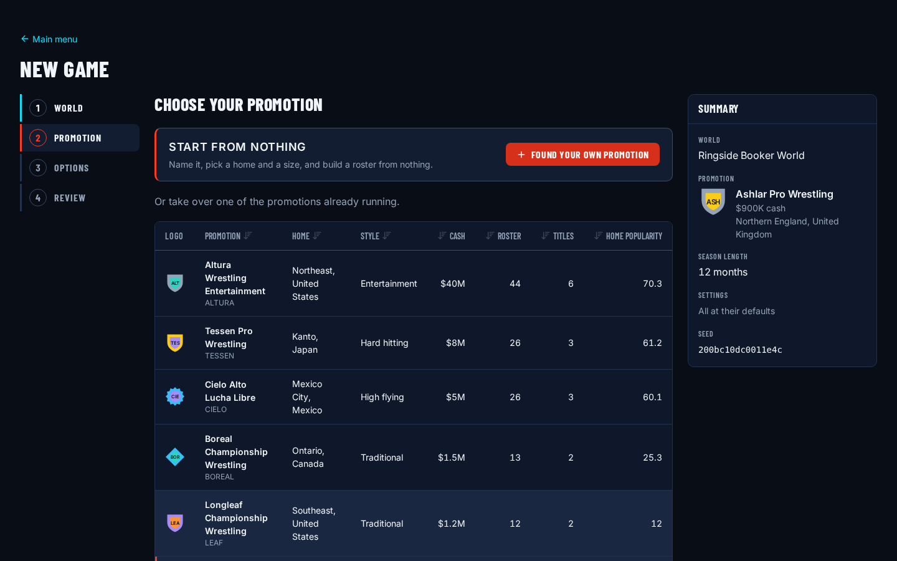
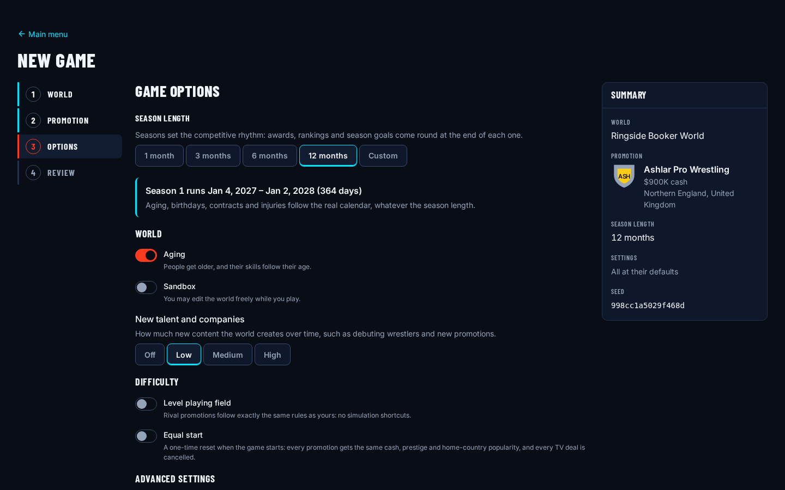
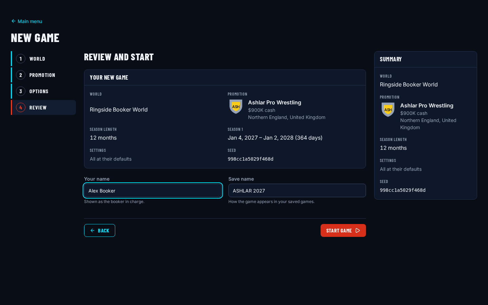
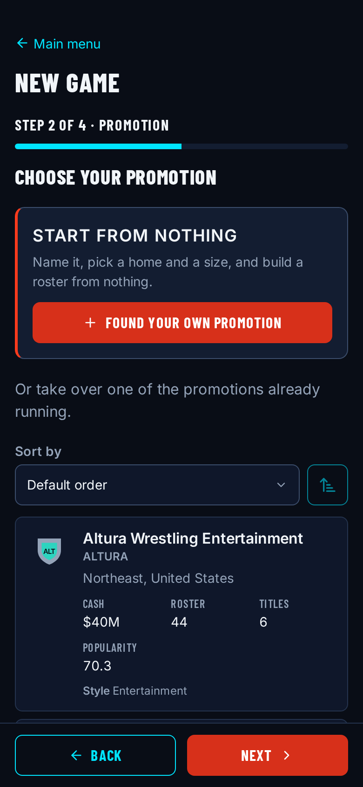
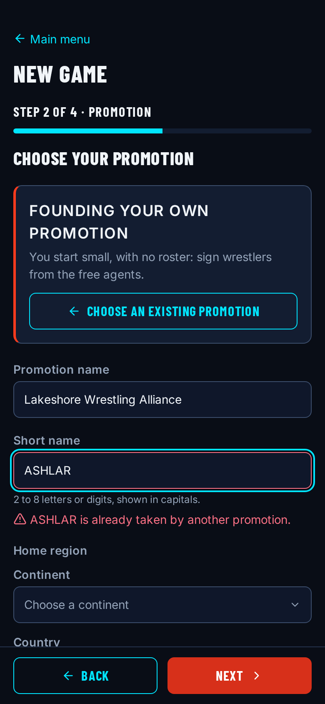

# World generation: a fictional world built from data packs

## Summary

The World generation epic is done. The game now has a content format of its own (data packs with
keys instead of IDs), a loader that turns packs into a checked World, and a validation tool that
refuses any real wrestler or promotion name. On top of that sit a map of 83 regions, name and
people generators that make believable, correlated people, and the default world: twelve
fictional promotions and 286 people, generated once from a fixed seed and committed as plain
JSON. A new game is one engine call that runs a registry of setup steps, hands the chosen
promotion to a human controller and creates season 1, and the new-game wizard drives it from the
browser in about a fifth of a second.

## What I built

- **WLD-01: Pack format.** A manifest schema (format version, pack kind, semver dependencies,
  start date, a file per record kind) and authoring schemas for all 23 record kinds, with the key
  and reference rules and the `$override` / `$remove` markers. A bare key and the same key
  qualified with its pack count as one record everywhere a duplicate is checked.
  `persistence/packs/manifest.ts`, `persistence/packs/keys.ts`, `persistence/packs/records/`,
  `docs/design/data-packs.md`
- **WLD-02: Pack loader.** `loadWorldFromPacks` resolves dependencies into a stable load order,
  merges records and overrides, checks every reference, then mints IDs in a fixed order and
  materialises the World in one transaction, returning issues instead of throwing for bad content.
  Name lists and generation numbers come back as a frozen content library rather than entities.
  `persistence/packs/resolve.ts`, `merge.ts`, `references.ts`, `materialise.ts`, `load.ts`,
  `library.ts`, `docs/design/data-packs.md#loading`
- **WLD-03: World validation tool.** `npm run validate:world` loads packs through the same loader
  the game uses, runs nine content rules (staffing, champions, reign dates, contract dates, unique
  names, geography, free agents, ages and the blocklist) and prints a distribution report. The
  real-name blocklist is committed, and CI runs the tool with `--strict` on every pull request.
  `tools/validate-world/`, `content/blocklist/real-names.txt`
- **WLD-04: Geography.** Six continents, 45 countries and 83 regions in the `base` pack, with
  populations, wrestling interest, preferred styles and mutual adjacency, plus lookups,
  population-weighted roll-ups that return traces, and weighted region picks.
  `systems/world/geography.ts`, `content/base/geography/`, `docs/design/geography.md`
- **WLD-05: Names.** 19 name cultures with hand-weighted lists, a name mix per country, ring name
  patterns built from 161 adjectives, 173 nouns and 88 nicknames, and a registry that keeps every
  legal name and ring name in a world unique. `systems/world/names/`, `content/base/names/`,
  `docs/design/names.md`
- **WLD-06: People generator.** `generatePerson` makes a person from a short spec: birthplace,
  gender, age and dates, ring style, body, body condition and every attribute, with attributes
  tied together through one hidden talent value. All the distributions are pack records (roles,
  styles, body archetypes, body modifiers, profiles), so balance lives in data.
  `systems/world/people/`, `content/base/generation/`, `docs/design/world-generation.md`
- **WLD-07: Potential, traits, vices and popularity.** Each new person gets ceilings and a
  potential number from one smooth curve over age, a set of traits from an incidence table with
  exclusive pairs, possibly a hidden vice, and a sparse regional popularity map that spreads out
  from home. A re-roll recomputes potential for people already in a world.
  `systems/world/people/potential.ts`, `traits.ts`, `vices.ts`, `popularity.ts`, `reseed.ts`,
  `docs/design/world-generation.md#potential-traits-vices-and-popularity-seeding`
- **WLD-08: The default world's organisations.** Twelve promotions in four tiers across seven
  countries, with brands, titles, venues, networks, TV deals and 40 recurring show definitions
  using slot-based formats. `validate:world` gained `--skip-rule` so CI could check the world
  while it was still being built. `content/worlds/default/`, `docs/design/default-world.md`
- **WLD-09: The default roster.** `npm run worldgen:default` builds every person, contract, team
  and title reign from a hand-written spec and 23 hand-written headliners, with a fixed seed, then
  runs the strict validation and rewrites the distribution report. The output is committed.
  `tools/worldgen/`, `content/worlds/default/people.json` and its siblings,
  `docs/design/default-world-report.md`
- **WLD-10: New game.** `createNewGame` parses the wizard's input, loads the packs with the chosen
  season length, runs the setup step registry (tunable overrides, founding, controllers, contract
  fix-ups, the optional resets, settings) and returns a ready engine state. `previewWorld`
  summarises a pack set for the wizard, and a settings registry decides which options exist.
  `systems/newgame/`, `docs/design/new-game.md`
- **WLD-11: New-game wizard.** A four-step screen (world, promotion, options, review) that runs
  in the engine worker against the bundled packs, lets you take over a promotion or found your
  own, checks names live, and lands in the office with the promotion's name in the top bar. Pack
  JSON is split into lazy chunks only the worker fetches. `apps/web/src/screens/new-game/`,
  `apps/web/src/worker/contentPacks.ts`, `apps/web/src/worker/engineHost.ts`,
  `apps/web/e2e/new-game.spec.ts`

Paths starting with `persistence/` or `systems/` are under `packages/engine/src/`.

On a phone the steps become a progress bar, the table becomes a list of cards, and Back and Next
sit in a bar at the bottom of the screen:

## Decisions and why

### Keys in packs, IDs in the engine

- **Decision:** Pack records name each other by readable keys (`pro-uk`, `us-southeast`). The
  loader swaps every key for an ID minted from the seed, in a fixed order by kind and then by key,
  and stores the key-to-ID map on the world metadata. A promotion's key is its slot in the world
  (`pro-flagship`), not its name.
- **Alternatives:** Authors writing engine IDs into packs; references by display name.
- **Why:** Engine IDs come from the seeded RNG, so the same record gets a different ID under a
  different seed, and nobody should have to type one. Names make terrible links: rename a
  promotion and every title and contract pointing at it breaks. Keys read well in a diff, stay
  the same across seeds, and let an add-on say "patch `pro-uk`" without knowing anything else.
  Minting by kind and key means the IDs are a pure function of the seed and the merged content,
  whatever order the files were passed in.
- **Revisit if:** Modders keep asking for a way to point at an entity created during play, which
  has no key. That would need a separate reference form, not a change to this one.

### The real-name blocklist is committed

- **Decision:** The list of real names the content must never use lives in the repo as a plain
  text file. The world validator always loads it, stops with an error if it is missing or empty,
  and the blog checker reads it through the same matching module.
- **Alternatives:** Keeping the list private, as a CI secret.
- **Why:** A secret list means a fork, a fresh clone or a pull request from outside runs the check
  against nothing and passes. Committed, it runs the same everywhere, and adding a near miss is a
  one-line change anyone can review. The file is plain text outside every pack, so the game never
  loads it and the browser bundle never contains it.
- **Revisit if:** The list grows so long that matching shows up in the validation time.

### Big regions instead of states and prefectures (D-03)

- **Decision:** 83 macro-regions: the United States is 12 regions, not 50 states, and small
  markets are one `<cc>-all` region. Popularity is stored only on regions; countries and
  continents are population-weighted roll-ups computed when a screen asks.
- **Alternatives:** Finer regions; separate country-level popularity.
- **Why:** Per-person popularity has to stay small in a save. With about 90 regions a world-famous
  star has a few dozen entries and most people far fewer, while a regional promotion still feels
  regional. A roll-up can't disagree with the regions under it, which two stored levels always
  end up doing.
- **Revisit if:** Touring wants finer places than a region, in which case a pack can split
  regions without the engine noticing.

### Correlated talent

- **Decision:** Each generated person draws one hidden talent value. Every attribute is the
  profile's mean plus a share of that talent and a share of its own noise, with a weight per
  attribute saying how much talent matters. Talent is handed to the potential and trait seeds and
  then dropped, never stored.
- **Alternatives:** Rolling each attribute on its own; storing talent as a visible stat.
- **Why:** Independent rolls make everyone average at everything, and a star only happens by
  accident. With one shared talent, a gifted worker tends to be good at the related skills, while
  the noise term still produces specialists like the great talker who can't go in the ring. The
  shares are chosen so the talent term never changes an attribute's spread, only how attributes
  move together, and the tests pin the resulting correlations. Not storing it keeps it a cause,
  not a number players learn to read instead of the attributes.
- **Revisit if:** Scouting needs a "raw ability" estimate, which can be worked out from the
  attributes the way the potential re-roll already does.

### A smooth potential curve, not age bands

- **Decision:** Room to grow comes from one smooth curve over fractional age: full at 18 and
  younger, falling to exactly zero at 35, with talent and a small fading variation on top. The
  same curve gives both the attribute ceilings and the potential number, so the two never
  disagree. The formula and its tunables are in
  [world-generation.md](../design/world-generation.md#potential).
- **Alternatives:** Age bands with a fixed potential range each, which is the quick way to do it.
- **Why:** Bands make birthdays into cliffs: a worker the day before a band boundary is a whole
  tier more promising than the same worker a day later. On the curve, a 30-year-old and a
  31-year-old differ by about a point and a half of headroom. It also suits the "smooth scaling
  instead of hard size tiers" default in the design decisions, and it is three tunables instead
  of a table of bands to balance.
- **Revisit if:** The Workers epic finds that growth needs the curve's shape changed by role,
  which would mean a curve per profile rather than bands.

### The default roster is generated once and committed

- **Decision:** The shipped world's 286 people come out of a build script with a fixed seed, and
  the output (`people.json`, `employments.json`, `teams.json`, `reigns.json`) is committed as
  plain pack JSON. The script refuses to overwrite hand edits unless forced, reads nothing from
  its own previous output, and rewrites the distribution report every time.
- **Alternatives:** Generating the world at new-game time from the same spec.
- **Why:** If the world were generated at new game, every tweak to a generator would silently
  change the shipped world, and two balance runs a week apart would be playing different rosters.
  Committed files are reviewable in a diff, can be polished by hand, and change only when I
  rebuild them on purpose. It also makes new game cheaper, since loading is faster than
  generating.
- **Revisit if:** Players want a "random world" option, which would call the same build at new
  game for a different seed, alongside the fixed world rather than instead of it.

### Slot-based show formats in the world data (D-10)

- **Decision:** The 40 recurring shows only say their importance; the slot counts come from it (5
  for house and minor shows, 6 for regular TV, 8 for a major, 10 for the flagship, plus a pre-show
  on the bigger cards). No length or minutes appear anywhere in the content.
- **Alternatives:** Writing a running time per show, to be divided into segments later.
- **Why:** D-10 says cards are built from slots, not minutes, so a running time in the data would
  be a number nothing reads, and worse, one that tempts a later system into reading it. Keeping the
  format to an importance level means the Events and Match epics can retune slot counts without
  touching 40 records.
- **Revisit if:** A promotion needs a format that doesn't follow from its importance, such as a
  three-hour special on a weekly slot.

### New game is a registry of setup steps

- **Decision:** Every option that changes the loaded world is a setup step with an order number,
  run through the same `runStep` the day pipeline uses, so each one gets its own transaction, RNG
  snapshot and report. The first step that fails stops new game, and nothing is saved. Later
  systems register their own steps (economy work goes at 900 and above) without editing the
  new-game code.
- **Alternatives:** One long `createNewGame` function with a branch per option.
- **Why:** New game is where every future system wants a say: repricing contracts, setting up
  production, assigning brand controllers. A registry keeps that from turning into one function
  everybody edits. Ordered steps make the interactions explicit, for example the equal-start reset
  at 600 runs before anything that sets up money, so it never throws their work away. Each step
  draws from its own stream, so turning one option on doesn't change what another option rolls.
- **Revisit if:** Steps start needing each other's results in ways an order number can't express.

### Season 1 is created when the world loads (D-08)

- **Decision:** The loader takes the season length as a setting and creates season 1 as part of
  the World: active, starting on the start date, ending on `startDate + lengthDays - 1`. New game
  stores the same length again in a later step.
- **Alternatives:** Creating season 1 lazily, on the first day or the first time a screen asks.
- **Why:** Every system that reads "the current season" can then assume there is one, from the
  first query onwards. A world with no season would be a special case every system has to handle,
  and the wizard's review step would have nothing to show when it says "Season 1 runs Jan 4, 2027
  to Jan 2, 2028". Doing it in the loader also means a modder's world and a tool's world get
  season 1 the same way the game does.
- **Revisit if:** The DAY epic's season-end processing wants seasons to start somewhere other than
  the start date, such as aligning with a calendar month.

### Options exist only when a system implements them

- **Decision:** The wizard draws its options from a settings registry. A setting appears only once
  a system has registered it, and its description says exactly what it does.
- **Alternatives:** A full options screen up front, with options greyed out or doing nothing until
  their systems arrive.
- **Why:** A checkbox that does nothing is a lie the player can't detect. With a registry, random
  winners and owner goals turn up in the wizard in the same change that makes them work. The one
  exception I allowed is the level playing field, because D-01 makes it a new-game choice and the
  rule it switches is easy to state; until the computer-promotion shortcuts exist, on and off
  play the same, and the design doc says so.
- **Revisit if:** Players ask for a roadmap of options. That belongs on a page, not in the wizard.

## How this differs from other games in the genre

- Every name in the world is fictional and checked by a tool on every change, with the list of
  names to avoid in the open.
- The world is data, not code. Promotions, people, maps, name lists and even the generation
  numbers are pack records, and an add-on can patch one field of one record by its key.
- Generated people are tied together by a hidden talent, so they come out as stars, specialists
  and journeymen rather than a spread of averages.
- Potential follows a smooth curve over age instead of bands, so nobody becomes less promising on
  a birthday.
- Popularity lives on regions only. Country and continent figures are always worked out from
  them, so a local hero is local and the numbers can't contradict each other.
- New game takes over any of twelve promotions or founds a new one, and season length is a choice,
  not a fixed year.

## Numbers

- **Tests:** 3,632 tests in 205 files across the repo (3,628 passed, 4 skipped), from
  `vitest run` on main at `e61de75`. The files this epic owns hold 571 of them in 28 files: 454
  in the engine (pack format and loader 253, geography, names and people 123, new game 64, the
  shipped content 14), 66 in `tools/validate-world`, 10 in `tools/worldgen` and 41 in the web
  app's wizard and content-pack tests. The wizard's end-to-end spec adds 3 Playwright tests, run
  on both the desktop and the phone project.
- **`validate:world` run time:** 2.5–3.0 s for `npm run validate:world` on my machine (Intel
  i5-13600KF, Node 20.20.1, WSL2), three runs. Calling the tool directly with
  `npx tsx tools/validate-world/src/cli.ts content/worlds/default --strict` takes 1.1–1.2 s, so
  more than half of the npm figure is npm and workspace start-up.
- **Default world:** 286 people (228 wrestlers, 20 referees, 18 announcers, 11 managers, 9
  producers), 12 promotions, 28 titles and 242 running contracts on the start date, with 35
  free-agent wrestlers and 44 people without a contract. `npm run worldgen:default` rebuilds all
  of it in about 1.5 s, and rebuilding twice left no diff.
- **People generator speed:** 1,000 people in 519–562 ms when the speed test runs on its own,
  three runs, against a target of 200 ms.
- **New game in the worker:** 192–203 ms from clicking Start game to the office's Dashboard
  heading, five runs in headless Chromium against the production build, each in a fresh browser
  profile. That covers building the world in the worker, installing the engine and saving the
  game to a slot. In Node, `createNewGame` alone takes 87–147 ms once warm (the first call is
  about 270 ms), and the first `previewWorld` about 400 ms.
- **Save size of a fresh game:** 126,589 bytes gzipped for a game taking over Ashlar Pro
  Wrestling and 126,761 bytes for a founded promotion with the starter kit, from 828,909 and
  830,146 characters of canonical JSON. That is about 124 KB on disk, and gzip takes it down by a
  factor of six and a half.
- **Coverage:** Not measured this time.

## What went wrong or surprised me

- **Two spellings of one key.** A reference can be a bare key or a pack-qualified one. My first
  duplicate checks compared the strings, so the same record written both ways counted twice, and
  regional popularity that named one region both ways quietly kept the second value. Both now
  compare the resolved record.
- **Malformed packs threw.** A pack whose files value wasn't an object crashed the loader with a
  `TypeError` instead of reporting an issue, which broke the "bad content never throws" promise
  on the first odd input. Data under a name that isn't a record kind is now an `unlisted-file`
  issue too.
- **The blocklist matched too little, then too much.** One-word entries let a leading "the" or a
  trailing year slip past, and short acronyms needed to match as whole words anywhere. Once that
  was tightened, the other side showed up: once the blog checker read the same list, names that
  are also ordinary words flagged everyday sentences in my posts, which is why the list now has a
  flag for case-sensitive entries.
- **Leap-day birthdays.** Adding years to 29 February lands on 28 February in a common year, a day
  before the age function counts the birthday. A debut at exactly the minimum age could therefore
  happen while the person was still a year too young. The debut date now starts from the first
  day the age function agrees.
- **Popularity where it shouldn't be.** Two regional promotions in the hand-written data had fans
  in a region that isn't next to their home. A new test holds regionals to home and neighbours
  and locals to home only, and caught both.
- **The preview froze my input.** `previewWorld` memoises its result and deep-freezes it, and the
  result held the caller's own manifest object, so a preview froze the packs the worker passed in.
  The preview now keeps its own copy.
- **Refusals with nowhere to go.** An engine refusal that names no field (a pack that won't load,
  a bad tunable override) sent the player to a step that only drew field errors, so the wizard
  said there was a problem and showed nothing. Each step now lists the problems none of its
  fields own.
- **Building a world in steps needed a switch.** The world content arrived over several tickets,
  and some content rules can't pass until later ones land: the geography rule wants a name mix
  for every country, and the staffing and free-agent rules want people. `--skip-rule` let CI check
  everything else in the meantime, and the rules were switched back on as their content arrived.
- **The generator is slower than its target.** 1,000 people take a little over half a second, not
  the 200 ms I aimed for. It doesn't matter yet, because the shipped world is built ahead of time,
  but newcomers during a game will use the same code.
- **npm costs more than the tool.** More than half of the `validate:world` time is npm starting a
  workspace script. CI doesn't care, but the number I'd quote was wrong until I timed both.
- **Better than expected:** new game, start to office, takes about a fifth of a second, and the
  first save of a 286-person world is about 124 KB. I had budgeted for a loading spinner and
  didn't need one.

## Open questions

- **Where the generator's time goes.** Half a second per thousand people is fine for a world built
  ahead of time. Whether it's fine for weekly newcomers and training schools depends on how many
  of them a year produces, which the Workers epic will tell me. Traces are the first suspect.
- **A random world option.** The committed roster is the right default. I don't know yet whether
  a "generate a fresh world from this seed" option is worth offering, or whether add-on worlds
  cover that need.
- **How hand edits to generated people survive.** A rebuild overwrites them unless they're moved
  into the spec. That's fine with one author; with contributors I may want a patch layer the build
  applies on top.
- **The promotion table on a desktop.** At 1,440 pixels wide the promotion and home columns wrap to
  three lines (visible in the first screenshot), and the table gets long. I'd like a denser layout
  before there are more worlds to choose from.
- **The level playing field option.** It is stored and shown, but does nothing until the
  computer-promotion shortcuts exist. I'm comfortable with that because its description is
  accurate, but it is the one option that breaks the "no dead checkboxes" rule.

## Blog angle

This entry feeds planned part 5, "Building a fictional wrestling world from scratch", for readers
who like games and some code but have never built a sim's content pipeline:

- **How a fictional wrestling world gets built from data packs.** Keys versus IDs, overrides for
  add-ons, the loader's four steps, and a validator that stops real names from creeping in. The
  wizard screenshots give the post a visual ending.
- **Making generated wrestlers feel like people.** The shared talent value and why it keeps
  attribute spreads honest, the smooth potential curve, traits with exclusive pairs, and
  popularity that spreads out from home. The worked examples in the design doc translate well.
- **Why I commit my generated roster.** A shorter piece on fixed seeds, reproducible builds and
  why "generate at new game" was the wrong default. It could be a section of part 5 rather than its
  own post.

## Raw notes

Nothing this time.

## Next

- **UI-14** closes the UI epic with its own journal entry. Together with this one, it covers a
  game you can start, save and load.
- **The Day and Workers epics** are the first big consumers of this world. DAY fills the day
  pipeline and adds season-end processing for the season 1 this epic creates; WRK gives the
  potential curve and the hidden talent their meaning over time.
- **Blog part 5** gets outlined from this entry.
